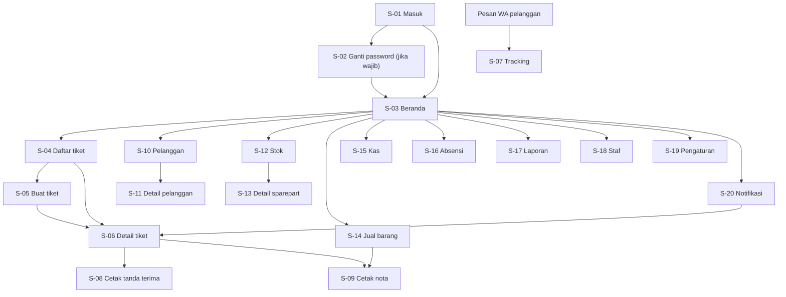
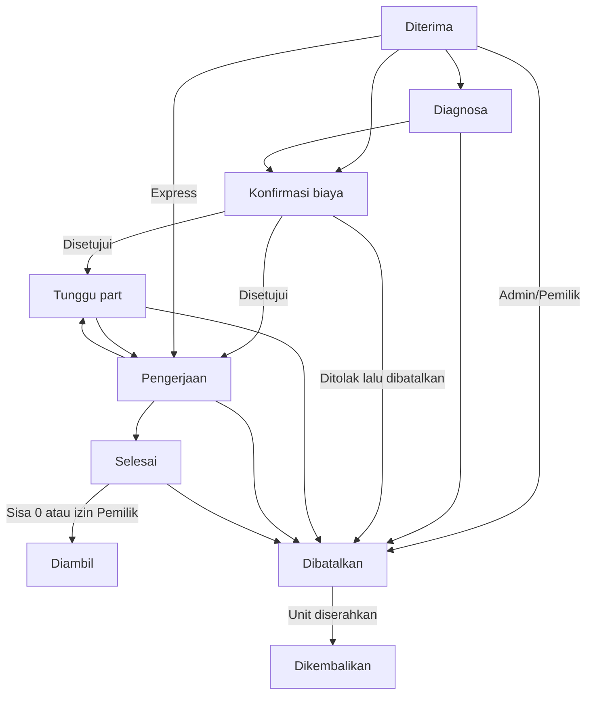
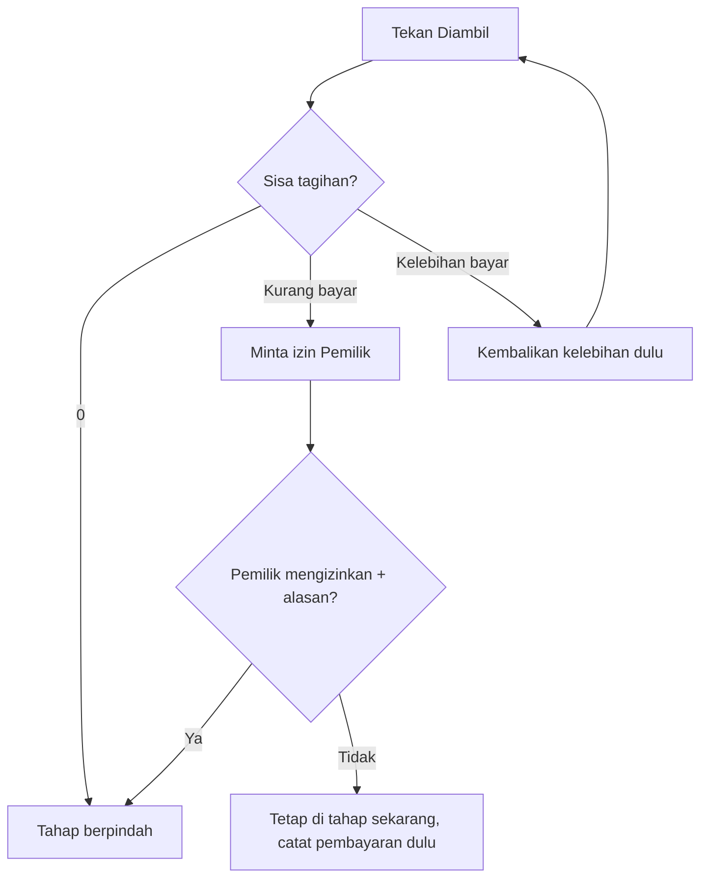

# AFD (App Flow Document) - Nuara Dashboard

> Versi: 0.3 | Diperbarui: 2026-11-26 | Merujuk: PRD.md (F-xx, peran)

> [!note] Sejak 2026-11-21 (wawancara P13)
> Layar S-xx di sini adalah target. Aplikasi sekarang memakai layar dan rute FixMaster (mis. `/services`, `/t/<kode>`); selisihnya dicatat di IPD "Daftar Selisih". Teks pesan baru tetap ditulis di sini lebih dulu.

> [!note] Keputusan selisih 2026-11-26 (P18)
> Bagian yang berubah mengikuti keputusan Pemilik atas 36 selisih ditandai (P18.n). Teks pesan untuk perilaku baru (persetujuan estimasi, Express, izin serah, absensi terlambat, dan lainnya) ditulis di sini saat langkah Fase C terkait (IPD L-70 s.d. L-82) dikerjakan, sebelum kodenya.

## 1. Peta Layar
<!-- Rute dashboard di host app.nuaraservice.my.id; S-07 di host lacak.nuaraservice.my.id. -->
| ID | Layar | Rute/URL | Akses | Fitur terkait |
|---|---|---|---|---|
| S-01 | Masuk | `/masuk` | Publik | F-08 |
| S-02 | Ganti password | `/ganti-password` | Pemilik, Admin, Teknisi | F-08 |
| S-03 | Beranda | `/beranda` | Pemilik, Admin, Teknisi (isi per peran) | F-13, F-10, F-09 |
| S-04 | Daftar tiket | `/tiket` | Pemilik, Admin, Teknisi | F-02, F-03, F-05, F-09 |
| S-05 | Buat tiket | `/tiket/baru` | Pemilik, Admin | F-01, F-15 |
| S-06 | Detail tiket | `/tiket/[id]` | Pemilik, Admin, Teknisi (aksi per peran) | F-01, F-02, F-03, F-05, F-06, F-07, F-09, F-15 |
| S-07 | Tracking pelanggan | `lacak.nuaraservice.my.id/[kode]` | Publik | F-04 |
| S-08 | Cetak tanda terima | `/cetak/tiket/[id]` | Pemilik, Admin | F-06 |
| S-09 | Cetak nota | `/cetak/nota/[id]` | Pemilik, Admin | F-07, F-17 |
| S-10 | Daftar pelanggan | `/pelanggan` | Pemilik, Admin | F-14 |
| S-11 | Detail pelanggan | `/pelanggan/[id]` | Pemilik, Admin | F-14 |
| S-12 | Stok | `/stok` | Pemilik, Admin | F-09 |
| S-13 | Detail sparepart | `/stok/[id]` | Pemilik, Admin | F-09 |
| S-14 | Jual barang | `/jual` | Pemilik, Admin | F-17 |
| S-15 | Kas | `/kas` | Pemilik, Admin | F-07, F-11 |
| S-16 | Absensi | `/absensi` | Pemilik, Admin, Teknisi | F-10 |
| S-17 | Laporan bulanan | `/laporan` | Pemilik | F-12 |
| S-18 | Staf | `/staf` | Pemilik | F-08 |
| S-19 | Pengaturan | `/pengaturan` | Pemilik | F-16 |
| S-20 | Notifikasi (tidak dibuat; diganti kartu "perlu tindakan" di Beranda, P18.22) | `/notifikasi` | Pemilik, Admin, Teknisi | F-02, F-03, F-07 |
| S-21 | Tidak ditemukan / tanpa akses | rute tak dikenal | Publik | - |

## 2. Navigasi Utama
Kerangka mengikuti L-47: sidebar di layar lebar, laci di tablet, tab bawah dan menu Lainnya di HP. Lonceng notifikasi tidak ditampilkan (P18.22) dan pemilih cabang disembunyikan (P18.21). Menu per peran (P18.19, P18.20, P18.24): Pemilik dan Admin = menu aplikasi sekarang (Beranda, Servis, Kalkulator Biaya, Kasir & Stok, Pelanggan, Supplier, Keuangan, Tugas, Absensi; Pemilik juga Laporan, Log Aktivitas, Pengaturan); Teknisi = Beranda, Tiket, Absensi, Tugas.

## 3. Alur per Fitur
Teks pesan persis yang tampil di layar hanya ditulis di bagian 3 sampai 5 dokumen ini; PRD dan dokumen lain merujuknya. Dashboard memakai kalimat netral tanpa sapaan; hanya S-07 yang menyapa "kamu".

### F-01 Terima unit + buat tiket
**Layar:** S-04, S-05, S-06
**Pemicu:** Admin menekan "Buat tiket" di S-04 atau S-03.
**Alur utama:**
1. Admin mengetik nomor WA di S-05; jika terdaftar, muncul "Nomor ini terdaftar atas nama <nama>. Pakai data ini?" dan nama terisi.
2. Admin memilih jenis perangkat; daftar keluhan template berganti sesuai jenis. Mengisi merek + tipe, keluhan, kelengkapan, kondisi fisik, password/pola (opsional), DP + akun kas (opsional), teknisi (opsional), centang Express (opsional; jika dicentang, kolom estimasi biaya + lama pengerjaan wajib).
3. Admin menekan "Simpan tiket"; sistem membuat nomor NS-xxxxx, kode tracking, pembayaran DP, riwayat "Diterima" (Express: lanjut "Pengerjaan").
4. S-06 terbuka dengan notifikasi "Tiket NS-0012 dibuat." dan tombol "Kirim link tracking" (F-05).

**Alur alternatif / gagal:**
- Input tidak valid -> pesan di bawah kolom: nomor WA "Nomor WA harus nomor seluler Indonesia, misalnya 0812 3456 7890."; keluhan kosong "Pilih minimal satu keluhan atau isi keluhan lain."
- Koneksi putus -> "Belum tersimpan. Cek koneksi internet, lalu tekan Coba lagi."; isian tetap; Coba lagi memakai kunci permintaan yang sama sehingga tidak terbentuk tiket ganda.
- Sesi habis -> ke S-01 dengan pesan "Sesi berakhir. Masuk lagi untuk melanjutkan.", lalu kembali ke S-05; isian (kecuali password/pola unit) dipulihkan dari draf di browser, dan draf dihapus setelah tiket tersimpan.
- Mengubah data tiket di S-06 (Admin/Pemilik) dengan nomor WA milik pelanggan lain -> "Nomor WA sudah dipakai <nama>."

### F-02 Tahap + tugaskan teknisi
**Layar:** S-04, S-06, S-20
**Pemicu:** Teknisi/Admin/Pemilik menekan tombol tahap di S-06.
**Alur utama:**
1. S-06 hanya menampilkan tombol tahap berikutnya yang sah untuk peran itu (BSD bagian 4).
2. Pengguna menekan tahap (opsional menulis catatan internal); untuk Selesai, isi biaya final dan garansi jasa + sparepart (hari).
3. Sistem menyimpan riwayat, mengirim sinyal realtime, dan membuat notifikasi sesuai bagian 5.
4. Notifikasi "Status diubah ke <tahap>."; untuk Selesai dan Diambil, Admin/Pemilik melihat tombol kirim WA.

**Alur alternatif / gagal:**
- Teknisi membuka tiket orang lain -> detail terbaca, tombol ubah tidak tampil; permintaan paksa ditolak "Tiket ini ditugaskan ke <nama teknisi>."
- Selesai tanpa garansi -> "Isi garansi jasa dan garansi sparepart (hari). Isi 0 jika tanpa garansi."
- Mundur tahap (Admin/Pemilik, hanya dari Diagnosa sampai Selesai) -> konfirmasi "Kembalikan ke <tahap sebelumnya>?"; tercatat di riwayat.
- Diambil, Dibatalkan, dan Dikembalikan -> konfirmasi "Tahap ini final dan tidak bisa dimundurkan. Lanjutkan?"
- Dibatalkan (Admin/Pemilik, dari Diterima sampai Selesai) -> isi alasan + biaya cek (boleh 0); jika dibayar melebihi biaya cek, S-06 menampilkan kelebihan bayar untuk dikembalikan (F-07.7).
- Dikembalikan (Admin/Pemilik, dari Dibatalkan): tombol "Tandai dikembalikan", tidak terkunci oleh sisa tagihan (P18.4).
- Koneksi putus -> pita "Tidak ada koneksi"; tombol menunggu, lalu Coba lagi.
- Sesi habis -> ke S-01, lalu kembali ke S-06.

### F-03 Estimasi + persetujuan
**Layar:** S-06, S-04, S-03
**Pemicu:** Teknisi yang ditugaskan menekan "Isi estimasi".
**Alur utama:**
1. Teknisi mengisi hasil diagnosa, estimasi biaya, perkiraan lama pengerjaan; tiket ke Konfirmasi biaya; estimasi siap tampil di kartu "perlu tindakan" Beranda Admin dan Pemilik (P18.22).
2. Admin (atau Teknisi yang ditugaskan) mengabari pelanggan lewat chat WA biasa, lalu menekan "Disetujui" atau "Ditolak" di S-06.
3. Disetujui -> tombol Pengerjaan/Tunggu part aktif. Ditolak oleh Admin/Pemilik -> dialog Batalkan terbuka (alasan terisi "Estimasi ditolak pelanggan", biaya cek diisi). Ditolak oleh Teknisi -> tiket tetap di Konfirmasi biaya dan tampil di kartu "perlu tindakan" Beranda Admin dan Pemilik untuk dibatalkan (P18.22).

**Alur alternatif / gagal:**
- Pengerjaan sebelum disetujui -> "Estimasi belum disetujui pelanggan. Tandai persetujuan dulu."
- Mengubah estimasi yang sudah Disetujui -> "Estimasi sudah disetujui. Selisih biaya diisi di biaya final saat Selesai."
- > 2 hari di Konfirmasi biaya tanpa keputusan, atau Ditolak tetapi belum dibatalkan -> label "Perlu ditindaklanjuti" di S-04 dan S-03.
- Koneksi putus / sesi habis -> sama dengan F-02.

### F-04 Halaman tracking pelanggan
**Layar:** S-07
**Pemicu:** Pelanggan membuka link dari WA atau memindai QR tanda terima.
**Alur utama:**
1. Sistem mencari tiket dari kode; jika aktif, menampilkan isi F-04.2 dalam gaya nota (tanpa nama pelanggan dan nama teknisi, P18.8; garansi tampil sebagai tanggal berakhir yang dihitung dari Selesai, garansi 0 tampil "Tanpa garansi", P18.11; kelengkapan, tombol Rute, dan teks pemberitahuan privasi di bagian bawah jika diisi).
2. Halaman tidak berubah sendiri; pelanggan memuat ulang untuk melihat tahap terbaru (P18.12).

**Alur alternatif / gagal:**
- Kode salah atau link kedaluwarsa (masa aktif di F-04.4; garansi dari Selesai, P18.11) -> "Link ini tidak ditemukan atau sudah tidak aktif. Tanyakan status servismu lewat WhatsApp." + tombol chat WA.
- Koneksi putus -> halaman terakhir tetap tampil + "Koneksi terputus. Muat ulang untuk melihat status terbaru."
- Sesi habis -> Tidak berlaku (tanpa login).

**Teks layar S-07** (menyapa "kamu"; kunci i18n `tracking.*`, diperbarui 2026-11-24 di L-56):
- Janji di kepala nota: "Pantau perbaikan perangkatmu di sini."
- Lembar nota: judul "Nota Servis"; isian "Perangkat" dan "Jenis"; satu cap bulat berisi tahap sekarang dan "Diperbarui <kapan>"; satu kalimat langkah berikut per tahap, mis. "Unit sedang ditangani teknisi. Tidak ada yang perlu kamu lakukan. Buka halaman ini lagi nanti untuk perkembangan terbaru." dan "Menunggu persetujuanmu atas estimasi biaya. Hubungi toko untuk melanjutkan atau membatalkan pengerjaan."
- Lembar pelanggan: "Garansi" dengan baris Jasa dan Sparepart ("s/d <tanggal>" atau "Tanpa garansi"). Rangkap teal: "Alur servis". Kartu: "Kontak Toko" dengan tombol "Chat WhatsApp", "Catatan Toko", dan "Syarat & Ketentuan" (tertutup).
- Gagal: "Status servis belum bisa dimuat." + "Biasanya karena koneksi internet sedang lemah. Nomor yang kamu masukkan tidak berubah, cukup coba lagi." + tombol "Coba lagi". Batas laju: "Terlalu banyak permintaan lacak dari jaringan ini." + "Tunggu sekitar satu menit, lalu coba lagi. Kodenya tidak salah." Tidak ditemukan: "Nomor <x> tidak ditemukan." / "Kode <x> tidak ditemukan." + petunjuk mencocokkan dengan nota (teks ini yang berlaku sekarang; kalimat "Link ini tidak ditemukan atau sudah tidak aktif..." di atas belum dipakai, masuk Daftar Selisih).
- Teks Syarat & Ketentuan memakai kunci `terms.*` yang sama dengan nota cetak dan masih menyapa "Anda" (G-07).

### F-05 Kabar status ke WA
**Layar:** S-06, S-04
**Pemicu:** Admin/Pemilik menekan tombol "Kirim link tracking" (Diterima), "Kabari siap diambil" (Selesai), atau "Minta ulasan" (Diambil); Teknisi tidak melihat tombol ini.
**Alur utama:**
1. Sistem menyusun pesan dari template + nomor tiket + link tracking (atau link ulasan).
2. Sistem mencatat jenis pesan, staf, waktu; lalu membuka `wa.me/<62xx>?text=...` di tab baru.
3. Staf menekan kirim di WhatsApp; penanda "Link belum dikirim" hilang dari S-04.

**Alur alternatif / gagal:**
- Link ulasan belum diisi -> tombol "Minta ulasan" tidak tampil; Pemilik melihat "Isi link ulasan Google di Pengaturan."
- WhatsApp tidak terbuka -> tombol "Salin pesan" menyalin teks lengkap.
- Koneksi putus -> pencatatan gagal: "Belum tercatat. Cek koneksi, lalu tekan lagi."

### F-06 Cetak tanda terima
**Layar:** S-06, S-08
**Pemicu:** Tombol "Cetak tanda terima" di S-06 (juga ditawarkan setelah tiket dibuat).
**Alur utama:**
1. S-08 terbuka dengan tata letak 58 atau 80 mm (Pengaturan) dan dialog cetak browser otomatis.
2. Laptop: pilih printer USB. Android: pilih print service RawBT.

**Alur alternatif / gagal:**
- Printer gagal -> tutup dialog, tekan "Cetak ulang" di S-06 kapan saja.
- Koneksi putus -> S-08 tidak termuat: "Tidak ada koneksi. Coba lagi."
- Sesi habis -> ke S-01, lalu kembali ke S-08.

### F-07 Catat pembayaran
**Layar:** S-06, S-09, S-15, S-20
**Pemicu:** Tombol "Catat pembayaran" di S-06.
**Alur utama:**
1. Admin melihat tagihan (jika sudah ditetapkan), sudah dibayar, sisa; mengisi nominal lalu membaginya ke satu atau beberapa akun kas; diskon bisa diisi mulai tahap Selesai.
2. Sistem menyimpan pembayaran + mutasi kas (jenis DP sebelum Selesai, pelunasan mulai Selesai); jika sisa = 0, label "Lunas".
3. Jika dibayar melebihi tagihan, S-06 menampilkan "Kelebihan bayar Rp<x>" dan tombol "Kembalikan kelebihan" (pilih akun kas, nominal sampai sebesar kelebihan).
4. Tawarkan "Cetak nota" (S-09) atau "Kirim nota via WA".

**Alur alternatif / gagal:**
- Nominal melebihi sisa (setelah tagihan ditetapkan) -> "Melebihi sisa tagihan Rp<sisa>."
- Split tidak sama -> "Jumlah per akun kas (Rp<x>) belum sama dengan nominal (Rp<y>)."
- Diskon melebihi biaya final -> "Diskon melebihi biaya final Rp<x>."
- Pembayaran salah -> "Batalkan pembayaran" + alasan; saldo kembali; catat ulang.
- Diambil saat kurang bayar -> "Sisa tagihan Rp<x>. Catat pembayaran atau minta izin Pemilik."
- Diambil saat kelebihan bayar -> "Ada kelebihan bayar Rp<x>. Kembalikan dulu."
- Pengembalian lebih besar dari kelebihan -> "Pengembalian melebihi kelebihan bayar Rp<x>."
- Pengembalian melebihi saldo akun -> "Saldo <akun> tinggal Rp<x>." (pilih akun lain atau pindah saldo dulu).
- Koneksi putus / sesi habis -> sama dengan F-02.

### F-08 Kelola akun staf
**Layar:** S-18, S-01, S-02
**Pemicu:** Pemilik menekan "Tambah staf" atau memilih staf di S-18.
**Alur utama:**
1. Pemilik mengundang staf lewat email (nama, email, peran, jadwal kerja); staf membuka undangan, mendaftar, dan masuk di S-01 dengan email dan password (P18.6).
2. Pemilik bisa mengubah peran/jadwal, "Reset password" (tautan pemulihan ke email staf), "Nonaktifkan" (konfirmasi; permintaan berikutnya dari sesi staf itu ditolak), atau "Aktifkan kembali".

**Alur alternatif / gagal:**
- Email sudah terdaftar -> pesan bawaan aplikasi (P18.6).
- Login salah dan pembatasan percobaan -> pesan bawaan aplikasi (P18.6).
- Pemilik menonaktifkan atau mengubah peran akunnya sendiri -> "Pemilik tidak bisa menonaktifkan atau mengubah peran akunnya sendiri."
- Akun nonaktif mencoba login -> "Akun ini sudah dinonaktifkan. Hubungi Pemilik."
- Koneksi putus / sesi habis -> sama dengan F-02.

### F-09 Stok sparepart
**Layar:** S-12, S-13, S-06, S-04, S-03
**Pemicu:** Admin menambah barang/barang masuk di S-12/S-13; Teknisi menekan "Pakai sparepart" di S-06, atau "Tambah sparepart" di baris tiket S-04 / daftar tiket Teknisi di S-03.
**Alur utama:**
1. Barang masuk: jumlah, harga beli, akun kas -> stok bertambah, harga modal dihitung ulang, uang keluar tercatat.
2. Pakai sparepart di tiket (dari S-06, atau dialog cepat di S-04/S-03 tanpa membuka detail): cari barang, isi jumlah -> stok berkurang, modal tiket bertambah (terlihat Pemilik); dialog tertutup dan baris tiket tetap di tempatnya.
3. Tidak ada di stok -> "Catat beli dadakan": nama part, harga, akun kas.
4. Batal dipasang -> "Kembalikan" (selama tiket belum Diambil atau Dikembalikan).

**Alur alternatif / gagal:**
- Jumlah > stok -> "Stok <nama> tinggal <n>."
- Saldo akun kurang (barang masuk/beli dadakan) -> "Saldo <akun> tinggal Rp<x>."
- Koreksi stok tanpa alasan -> "Tulis alasan koreksi (rusak, hilang, salah hitung)."
- Koneksi putus / sesi habis -> sama dengan F-02.

### F-10 Absensi staf
**Layar:** S-16, S-03
**Pemicu:** Staf menekan "Absen masuk"/"Absen pulang".
**Alur utama:**
1. Browser meminta lokasi; server menghitung jarak ke titik workshop dan menyimpan absen beserta jaraknya jika dalam radius 100 m.
2. Tampil "Masuk 08.02, lokasi terverifikasi" (atau "Terlambat 12 menit").
3. Staf melihat riwayat bulan ini; Pemilik melihat rekap semua staf, mengisi jam pulang yang lupa, atau mencatat absensi manual (wajib alasan).

**Alur alternatif / gagal:**
- Izin lokasi ditolak/GPS gagal -> absen tetap tersimpan, label "Lokasi tidak terverifikasi".
- Di luar radius -> absen ditolak "Posisi <jarak> m dari workshop. Absen hanya bisa dalam radius 100 m."
- Sudah absen masuk -> "Sudah absen masuk pukul <jam>."
- Titik workshop belum diset -> "Titik lokasi workshop belum diatur Pemilik." (absen tersimpan tanpa verifikasi).
- Koneksi putus / sesi habis -> sama dengan F-02.

### F-11 Catat pengeluaran
**Layar:** S-15
**Pemicu:** Admin menekan "Catat pengeluaran" atau "Pindah saldo"; Pemilik juga "Koreksi saldo".
**Alur utama:**
1. Isi tanggal, nominal, akun kas, keterangan (atau akun asal, akun tujuan, nominal) -> tersimpan, saldo berubah.
2. S-15 menampilkan mutasi per hari per akun dan saldo saat ini.

**Alur alternatif / gagal:**
- Saldo kurang -> "Saldo <akun> tinggal Rp<x>."
- Salah input -> "Batalkan" + alasan, lalu catat ulang.
- Koreksi saldo tanpa alasan -> "Tulis alasan koreksi saldo."
- Koreksi yang membuat saldo minus -> "Saldo <akun> tidak boleh minus."
- Koneksi putus / sesi habis -> sama dengan F-02.

### F-12 Laporan keuangan bulanan
**Layar:** S-17
**Pemicu:** Pemilik membuka S-17 dan memilih bulan (default bulan berjalan).
**Alur utama:**
1. Tampil omzet, biaya barang, pengeluaran, profit, jumlah tiket per status, tiket per jenis perangkat, kinerja teknisi, masing-masing dengan selisih dari bulan lalu.

**Alur alternatif / gagal:**
- Bulan tanpa data -> "Belum ada data untuk <bulan>."
- Admin/Teknisi membuka -> S-21 "Halaman ini khusus Pemilik."
- Koneksi putus / sesi habis -> sama dengan F-02.

### F-13 Beranda ringkasan
**Layar:** S-03
**Pemicu:** Login atau menu Beranda.
**Alur utama:**
1. Isi sesuai peran (PRD F-13.1-F-13.3); setiap kartu "perlu tindakan" membuka S-04 dengan filter terkait.
2. Angka berubah sendiri lewat sinyal realtime.

**Alur alternatif / gagal:**
- Koneksi putus -> angka terakhir tetap + pita "Tidak ada koneksi".
- Sesi habis -> ke S-01.

### F-14 Data pelanggan + riwayat
**Layar:** S-10, S-11
**Pemicu:** Menu Pelanggan atau nama pelanggan di S-06.
**Alur utama:**
1. Cari nama/WA di S-10 -> S-11 menampilkan nama, WA, riwayat tiket.
2. Pemilik menghapus pelanggan dari daftar (konfirmasi); nama dan nomor yang sudah disalin ke tiket lama tetap tampil (P18.29). Fitur Samarkan tidak dibuat.

**Alur alternatif / gagal:**
- Pencarian kosong -> "Tidak ada pelanggan dengan nama atau nomor itu."
- Koneksi putus / sesi habis -> sama dengan F-02.

### F-15 Klaim garansi
**Layar:** S-06, S-05
**Pemicu:** Tombol "Klaim garansi" di S-06 tiket Diambil.
**Alur utama:**
1. Pilih garansi jasa atau sparepart -> S-05 terisi data pelanggan dan perangkat dari tiket lama, biaya awal Rp0 dan estimasi Rp0 yang langsung Disetujui, tautan ke tiket lama.
2. Simpan -> tiket baru NS- berikutnya, alur F-01 seterusnya.

**Alur alternatif / gagal:**
- Garansi berakhir -> tombol tidak tersedia, teks "Garansi <jenis> berakhir <tanggal>."
- Koneksi putus / sesi habis -> sama dengan F-01.

### F-16 Pengaturan template
**Layar:** S-19
**Pemicu:** Pemilik membuka menu Pengaturan.
**Alur utama:**
1. Bagian: Template (keluhan, kelengkapan, pesan WA, S&K, teks pemberitahuan privasi), Tracking & ulasan (link ulasan Google), Cetak (58/80 mm), Kas (akun kas + saldo awal), Garansi awal, Absensi (titik lokasi lewat tombol "Pakai lokasi saya sekarang", toleransi terlambat).
2. Simpan per bagian -> "Pengaturan disimpan." (di aplikasi tiap kartu memakai teks sendiri, mis. "Template dan link ulasan disimpan", "Toleransi terlambat disimpan").
3. Keluhan dikelola per jenis perangkat: pilih jenis, lalu tambah atau hapus pilihan cepatnya. Jenis bawaan Laptop/PC, HP, dan Elektronik rumah tangga berisi 16 keluhan awal dari nota landing page; jenis tanpa daftar sendiri memakai daftar umum (P18.35). Toleransi terlambat kosong = 0 menit, dan teks pemberitahuan privasi kosong = tidak ditampilkan.

**Alur alternatif / gagal:**
- Link ulasan bukan https -> "Link ulasan harus diawali https://."; format rusak, bersepasi, atau berisi kredensial -> "Link ulasan tidak valid. Tempel alamat lengkap tanpa spasi."; lebih dari 300 karakter -> "Link ulasan terlalu panjang (maksimal 300 karakter)." Tidak ada yang tersimpan sampai link benar.
- Toleransi terlambat bukan bilangan bulat 0 sampai 120 -> "Toleransi harus bilangan bulat 0 sampai 120 menit."
- Saldo awal diubah setelah akun kas punya mutasi -> "Saldo awal tidak bisa diubah. Pakai Koreksi saldo di Kas."
- Izin lokasi ditolak saat set titik -> "Izinkan akses lokasi untuk menyimpan titik workshop."
- Koneksi putus / sesi habis -> sama dengan F-02.

### F-17 Jual barang langsung
**Layar:** S-14, S-09
**Pemicu:** Menu Jual barang.
**Alur utama:**
1. Cari barang, isi jumlah (bisa beberapa barang), diskon opsional, nama/WA pembeli opsional (jika WA diisi, nama wajib).
2. Bayar dengan satu atau beberapa akun kas -> nota JL-xxxxx, stok berkurang.
3. Tawarkan cetak nota (S-09) atau kirim via WA (jika WA pembeli diisi).

**Alur alternatif / gagal:**
- Jumlah > stok -> "Stok <nama> tinggal <n>."
- WA pembeli diisi tanpa nama -> "Isi nama pembeli jika nomor WA diisi."
- Nomor WA pembeli tidak valid -> "Nomor WA harus nomor seluler Indonesia, misalnya 0812 3456 7890."
- Salah jual -> "Batalkan penjualan" + alasan; stok dan saldo kembali.
- Koneksi putus / sesi habis -> sama dengan F-02.

## 4. State Layar
| Layar | Kosong | Loading | Error | Sukses |
|---|---|---|---|---|
| S-01 | Tidak berlaku | Tombol "Masuk" berputar | Pesan di atas form (F-08) | Ke beranda per peran |
| S-02 | Tidak berlaku | Tombol berputar | "Password minimal 8 karakter." / "Password lama salah." | "Password diganti." -> S-03 |
| S-03 | "Belum ada yang perlu ditindaklanjuti." | Kerangka kartu | Pita error + Coba lagi | Kartu berisi angka |
| S-04 | "Belum ada tiket. Terima unit pertama." + Buat tiket (Teknisi: "Belum ada tiket yang ditugaskan.") | Kerangka baris | Pita error + Coba lagi | Daftar + filter |
| S-05 | Tidak berlaku | Tombol "Simpan tiket" berputar | Pesan per kolom / pesan koneksi | -> S-06 + "Tiket NS-xxxxx dibuat." |
| S-06 | Riwayat: "Belum ada catatan." | Kerangka | "Tiket tidak ditemukan." | Detail + aksi per peran |
| S-07 | Tidak berlaku | Kerangka nota | Pesan link tidak aktif + chat WA | Nota tracking |
| S-08 | Tidak berlaku | "Menyiapkan tanda terima..." | "Tidak ada koneksi. Coba lagi." | Dialog cetak terbuka |
| S-09 | Tidak berlaku | "Menyiapkan nota..." | "Tidak ada koneksi. Coba lagi." | Dialog cetak terbuka |
| S-10 | "Belum ada pelanggan. Pelanggan tercatat otomatis saat tiket dibuat." | Kerangka baris | Pita error + Coba lagi | Daftar |
| S-11 | Riwayat: "Belum ada tiket." | Kerangka | "Pelanggan tidak ditemukan." | Detail |
| S-12 | "Belum ada sparepart. Tambah barang pertama." + Tambah barang | Kerangka baris | Pita error + Coba lagi | Daftar + label stok menipis |
| S-13 | Riwayat: "Belum ada mutasi." | Kerangka | "Barang tidak ditemukan." | Detail + riwayat |
| S-14 | "Belum ada penjualan hari ini." + Jual barang | Kerangka | Pita error + Coba lagi | Nota JL-xxxxx dibuat |
| S-15 | "Belum ada mutasi kas hari ini." | Kerangka | Pita error + Coba lagi | Mutasi + saldo |
| S-16 | "Belum ada absensi bulan ini." | Tombol absen berputar | Pesan absen (F-10) | "Masuk <jam>, <status lokasi>" |
| S-17 | "Belum ada data untuk <bulan>." | Kerangka angka | Pita error + Coba lagi | Laporan |
| S-18 | Tidak berlaku (minimal akun Pemilik) | Kerangka baris | Pita error + Coba lagi | Daftar staf |
| S-19 | Tidak berlaku (data awal terisi) | Kerangka form | Pesan per kolom | "Pengaturan disimpan." |
| S-20 | (layar tidak dibuat, P18.22) | - | - | - |
| S-21 | Tidak berlaku | Tidak berlaku | "Halaman tidak ditemukan." / "Halaman ini khusus <peran>." + tombol ke Beranda | Tidak berlaku |

## 5. Aturan Lintas Layar
- Redirect setelah login: ke S-03 sesuai peran; sebelum F-13 selesai, Admin/Pemilik ke S-04 dan Teknisi ke S-04 dengan filter "Tiket saya". Jika `must_change_password`, selalu ke S-02 dulu.
- Akses tanpa izin: belum login -> S-01 lalu kembali ke halaman tujuan; peran tak berizin -> S-21 "Halaman ini khusus <peran>." + tombol ke Beranda.
- Sesi habis di layar staf: ke S-01 dengan pesan "Sesi berakhir. Masuk lagi untuk melanjutkan.", lalu kembali ke halaman tujuan. Akun yang dinonaktifkan: permintaan berikutnya ditolak dan diarahkan ke S-01 dengan pesan "Akun ini sudah dinonaktifkan. Hubungi Pemilik."
- Halaman tidak ditemukan (404): S-21 "Halaman tidak ditemukan." + tombol ke Beranda (host lacak.: pesan link tidak aktif F-04.7).
- Koneksi putus: pita "Tidak ada koneksi" di atas layar staf; isian form tidak hilang; tombol simpan menampilkan Coba lagi.
- Realtime: S-03, S-04, S-06 mengambil ulang data saat menerima sinyal; pemuatan ulang digabung (layar staf paling sering sekali per 2 detik); S-07 tidak berubah sendiri (P18.12); layar lain dimuat ulang saat dibuka.
- Kejadian untuk kartu "perlu tindakan" di Beranda (pengganti notifikasi, P18.22; tanpa lonceng dan tanpa push). Teks kartu final ditulis saat IPD L-72 dikerjakan:
  - Tiket ditugaskan -> Teknisi tersebut: "Tiket NS-0012 ditugaskan."
  - Estimasi diisi -> semua Admin + Pemilik: "Estimasi NS-0012 siap dikonfirmasi ke pelanggan."
  - Estimasi ditolak oleh Teknisi -> semua Admin + Pemilik: "Estimasi NS-0012 ditolak pelanggan. Batalkan tiket dan isi biaya cek."
  - Tiket Selesai -> semua Admin + Pemilik: "NS-0012 selesai. Kabari pelanggan."
  - Minta izin serah belum lunas -> Pemilik: "NS-0012 diminta diambil, sisa tagihan Rp<x>." (tiket Dibatalkan: "NS-0012 diminta dikembalikan, sisa biaya cek Rp<x>.")
- Nada teks: dashboard netral tanpa sapaan (tanpa "kamu", "Anda", "-mu"); hanya S-07 yang menyapa "kamu".
- Pesan WA ke pelanggan (dikirim staf lewat wa.me): Diterima (nomor tiket + link tracking), Selesai (siap diambil), Diambil (permintaan ulasan + link ulasan). Teks dari Pengaturan (F-16).
