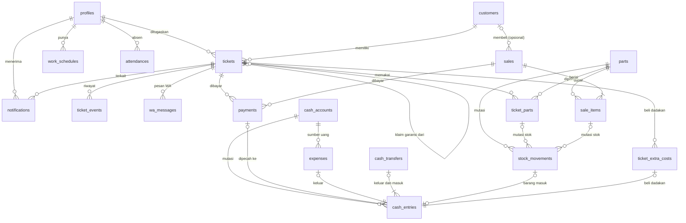

# BSD (Backend & Schema Document) - Nuara Dashboard

> Versi: 0.2 | Diperbarui: 2026-11-04 | Merujuk: PRD.md, TRD.md, AFD.md
> Database: PostgreSQL 17 (Supabase) | Auth: Supabase Auth (schema `auth`, dikelola penyedia) | ORM/migrasi: Drizzle ORM + drizzle-kit

## 1. ERD

Tabel `settings`, `counters`, `audit_logs`, dan `login_attempts` berdiri sendiri (tanpa relasi FK, kecuali kolom pelaku ke `profiles`).

## 2. Konvensi
- Nama tabel: `snake_case` jamak; PK: `uuid` (default `gen_random_uuid()`), kecuali `profiles.id` (= `auth.users.id`), `settings.key`, dan `counters.name`.
- Kolom standar: `created_at`, `updated_at` (`timestamptz`, default `now()`; disimpan UTC, ditampilkan Asia/Jakarta).
- Soft delete: tidak ada hapus untuk data bisnis. Tiket -> tahap `dibatalkan` lalu `dikembalikan`; uang, stok, penjualan -> kolom `voided_at`, `voided_by`, `void_reason`; akun staf -> `profiles.is_active`; pelanggan -> `is_anonymized`.
- Uang: `bigint` rupiah utuh (tanpa desimal). Jumlah barang: `integer`.
- Nomor urut tanpa lompatan: tabel `counters` di-`UPDATE ... RETURNING` dalam transaksi yang sama dengan insert (bukan sequence Postgres, karena sequence bisa melompat saat rollback).
- Auth: kredensial, sesi, dan token dikelola Supabase Auth (schema `auth`); aplikasi tidak menulis ke schema itu kecuali lewat API Auth. Peran dan status aktif hanya di `profiles`.
- Semua tabel `public`: `ENABLE ROW LEVEL SECURITY` tanpa policy (akses hanya lewat server, TRD bagian 5). Pengecualian: policy pada `realtime.messages` (bagian 6).

## 3. Tabel

### profiles
Fitur: F-08 | Tujuan: akun staf (peran, status aktif). `auth.users` (email sintetis `<username>@staf.nuaraservice.my.id`, `email_confirm = true`, tidak pernah dipakai mengirim email) dan sesi dikelola Supabase Auth.
| Kolom | Tipe | Constraint | Keterangan |
|---|---|---|---|
| id | uuid | PK, FK -> auth.users.id ON DELETE RESTRICT | Sama dengan id akun Auth |
| name | text | NOT NULL | Nama staf, maks 80 |
| username | text | NOT NULL, UNIQUE, CHECK `^[a-z0-9._]{3,30}$` | Huruf kecil |
| role | user_role | NOT NULL | owner / admin / technician; satu-satunya sumber peran (tidak ada di JWT, `user_metadata`, atau `app_metadata`) |
| is_active | boolean | NOT NULL, default true | false = nonaktif |
| must_change_password | boolean | NOT NULL, default true | Paksa ke S-02 |
| created_at, updated_at | timestamptz | NOT NULL | |

Indeks: `username` (unik). Relasi: 1 `auth.users` -> 1 profiles (dibuat `createStaff`; akun Auth dihapus kembali bila insert `profiles` gagal). Aturan: selalu ada minimal satu Pemilik aktif; Pemilik tidak bisa menonaktifkan atau mengubah peran akunnya sendiri (F-08.7).

### work_schedules
Fitur: F-08, F-10 | Tujuan: jadwal kerja per hari.
| Kolom | Tipe | Constraint | Keterangan |
|---|---|---|---|
| id | uuid | PK | |
| user_id | uuid | NOT NULL, FK -> profiles.id | |
| weekday | smallint | NOT NULL, CHECK 1-7 | 1 = Senin |
| start_time | time | NOT NULL | Jam masuk |
| end_time | time | NOT NULL, CHECK > start_time | Jam pulang |
| created_at, updated_at | timestamptz | NOT NULL | |

Indeks: UNIQUE (`user_id`, `weekday`). Hari tanpa baris = libur.

### login_attempts
Fitur: TRD 5 | Tujuan: kunci 5x salah per 15 menit per (username, IP) dan batas per IP.
| Kolom | Tipe | Constraint | Keterangan |
|---|---|---|---|
| id | uuid | PK | |
| username | text | NOT NULL | |
| ip | text | NOT NULL | Dari `x-forwarded-for` Vercel |
| succeeded | boolean | NOT NULL | |
| created_at | timestamptz | NOT NULL, default now() | |

Indeks: (`username`, `ip`, `created_at`) -> hitung kegagalan pasangan dalam 15 menit; (`ip`, `created_at`) -> hitung kegagalan per IP dalam 15 menit.

### customers
Fitur: F-01, F-14 | Tujuan: pelanggan; satu nomor WA = satu pelanggan.
| Kolom | Tipe | Constraint | Keterangan |
|---|---|---|---|
| id | uuid | PK | |
| name | text | NOT NULL | Maks 80 karakter |
| phone | text | NOT NULL, UNIQUE, CHECK (`^628[0-9]{8,11}$`, atau `anon-` + uuid bila `is_anonymized`) | Format seragam F-01.3: 628 diikuti 8-11 digit |
| is_anonymized | boolean | NOT NULL, default false | true -> name "Pelanggan dihapus", phone diganti `anon-<uuid>` |
| anonymized_at | timestamptz | | |
| created_at, updated_at | timestamptz | NOT NULL | |

Indeks: `phone` (unik; cari WA). Pencarian nama memakai ILIKE tanpa indeks khusus (sekitar 2.400 tiket per tahun); tambahkan indeks trigram bila terasa lambat. Relasi: 1 customers -> N tickets (ON DELETE RESTRICT).

### tickets
Fitur: F-01, F-02, F-03, F-04, F-06, F-07, F-15 | Tujuan: tiket servis.
| Kolom | Tipe | Constraint | Keterangan |
|---|---|---|---|
| id | uuid | PK | |
| number | integer | NOT NULL, UNIQUE | Ditampilkan `NS-` + 5 digit; dari `counters` 'ticket' |
| client_request_id | uuid | NOT NULL, UNIQUE | Mencegah tiket ganda saat Coba lagi (F-01.11) |
| tracking_code | text | NOT NULL, UNIQUE | 10 karakter base62 acak |
| customer_id | uuid | NOT NULL, FK -> customers.id | |
| device_type | device_type | NOT NULL | |
| device_brand_model | text | NOT NULL | Maks 80 |
| complaints | text[] | NOT NULL, default '{}' | Dari template |
| complaint_other | text | | Maks 160; CHECK complaints tidak kosong atau kolom ini terisi |
| accessories | text[] | NOT NULL, default '{}' | |
| physical_condition | text | | Maks 300 |
| unlock_secret_enc | text | | AES-256-GCM; NULL setelah dihapus |
| unlock_secret_purged_at | timestamptz | | |
| is_express | boolean | NOT NULL, default false | |
| stage | ticket_stage | NOT NULL, default 'diterima' | |
| stage_changed_at | timestamptz | NOT NULL, default now() | Untuk "> 2 hari di Konfirmasi biaya" |
| technician_id | uuid | FK -> profiles.id | NULL = belum ditugaskan |
| diagnosis | text | | Maks 500 |
| estimate_amount | bigint | CHECK >= 0 | |
| estimate_duration | text | | Mis. "2-3 hari kerja", maks 40 |
| estimate_decision | estimate_decision | NOT NULL, default 'belum_diisi' | Tiket Express dan tiket klaim garansi: 'disetujui' saat dibuat |
| estimate_decided_at | timestamptz | | |
| estimate_decided_by | uuid | FK -> profiles.id | |
| final_amount | bigint | CHECK >= 0 | Diisi saat Selesai |
| discount_amount | bigint | NOT NULL, default 0, CHECK >= 0 | Diisi mulai tahap Selesai; 0 bila `final_amount` kosong, selain itu <= `final_amount` |
| check_fee | bigint | CHECK >= 0 | Diisi saat Dibatalkan |
| service_warranty_days | integer | CHECK >= 0 | Wajib saat Selesai |
| part_warranty_days | integer | CHECK >= 0 | Wajib saat Selesai |
| completed_at | timestamptz | | Masuk Selesai |
| picked_up_at | timestamptz | | Masuk Diambil |
| cancelled_at | timestamptz | | Masuk Dibatalkan |
| returned_at | timestamptz | | Masuk Dikembalikan |
| cancel_reason | text | | Wajib saat Dibatalkan |
| pickup_override_requested_at | timestamptz | | Admin minta izin serah saat kurang bayar (tahap Diambil atau Dikembalikan) |
| pickup_override_by | uuid | FK -> profiles.id | Pemilik yang mengizinkan |
| pickup_override_reason | text | | |
| warranty_claim_of_id | uuid | FK -> tickets.id | Tiket lama (F-15) |
| warranty_claim_type | warranty_type | | CHECK terisi jika warranty_claim_of_id terisi |
| created_by | uuid | NOT NULL, FK -> profiles.id | |
| created_at, updated_at | timestamptz | NOT NULL | |

Indeks: `number`, `tracking_code`, `client_request_id` (unik); (`stage`, `stage_changed_at`) -> daftar & perlu tindakan; `technician_id`; `customer_id`; `picked_up_at`, `cancelled_at`, `created_at` -> laporan bulanan.
Relasi: N tickets -> 1 customers (RESTRICT); N tickets -> 1 profiles teknisi (RESTRICT); klaim -> tiket lama (RESTRICT).
Turunan (dihitung, tidak disimpan):
- tagihan: mulai Selesai = `final_amount - discount_amount`; Dibatalkan atau Dikembalikan = `check_fee`; sebelum Selesai belum ditetapkan.
- dibayar = jumlah `payments` jenis `dp` dan `pelunasan` dikurangi jumlah `refund`, tanpa yang `voided_at`; sisa = tagihan - dibayar (positif = kurang bayar, negatif = kelebihan bayar); lunas = tagihan ditetapkan dan sisa = 0 (F-07.3).
- berakhir garansi = `picked_up_at` + hari garansi.
- link tracking aktif: belum Diambil atau Dibatalkan = selalu; Diambil = garansi terpanjang + 30 hari (garansi 0: `picked_up_at` + 30 hari); Dibatalkan atau Dikembalikan = `cancelled_at` + 30 hari (F-04.4).
- biaya barang tiket = jumlah (`ticket_parts.qty x unit_cost` yang `returned_at` kosong) + jumlah `ticket_extra_costs.amount` yang tidak `voided_at` (F-12.1).

### ticket_events
Fitur: F-02, F-04 | Tujuan: riwayat tahap, penugasan, catatan internal.
| Kolom | Tipe | Constraint | Keterangan |
|---|---|---|---|
| id | uuid | PK | |
| ticket_id | uuid | NOT NULL, FK -> tickets.id | |
| event_type | ticket_event_type | NOT NULL | |
| from_stage | ticket_stage | | Untuk event 'stage' |
| to_stage | ticket_stage | | Untuk event 'stage' |
| is_revert | boolean | NOT NULL, default false | Mundur tahap |
| note | text | | Maks 500; selalu internal |
| actor_id | uuid | NOT NULL, FK -> profiles.id | |
| created_at | timestamptz | NOT NULL, default now() | Waktu yang tampil di tracking |

Indeks: (`ticket_id`, `created_at`). Tracking hanya membaca `event_type = 'stage'` (tanpa `note`, tanpa nama aktor).

### wa_messages
Fitur: F-05 | Tujuan: catatan tombol WA ditekan.
| Kolom | Tipe | Constraint | Keterangan |
|---|---|---|---|
| id | uuid | PK | |
| ticket_id | uuid | NOT NULL, FK -> tickets.id | |
| kind | wa_kind | NOT NULL | |
| sent_by | uuid | NOT NULL, FK -> profiles.id | |
| created_at | timestamptz | NOT NULL, default now() | |

Indeks: (`ticket_id`, `kind`). "Link belum dikirim" = tiket tanpa baris `kind = 'diterima'`.

### notifications
Fitur: F-02, F-03, F-07 | Tujuan: lonceng di aplikasi (AFD bagian 5).
| Kolom | Tipe | Constraint | Keterangan |
|---|---|---|---|
| id | uuid | PK | |
| user_id | uuid | NOT NULL, FK -> profiles.id | Penerima |
| kind | notification_kind | NOT NULL | |
| ticket_id | uuid | NOT NULL, FK -> tickets.id | |
| message | text | NOT NULL | Teks AFD bagian 5 |
| read_at | timestamptz | | |
| created_at | timestamptz | NOT NULL, default now() | |

Indeks: (`user_id`, `read_at`, `created_at`).

### cash_accounts
Fitur: F-07, F-11, F-16 | Tujuan: akun kas = metode bayar.
| Kolom | Tipe | Constraint | Keterangan |
|---|---|---|---|
| id | uuid | PK | |
| name | text | NOT NULL, UNIQUE | Diberi Pemilik (mis. nama rekening) |
| opening_balance | bigint | NOT NULL, default 0 | Saldo awal; hanya bisa diubah selama akun belum punya `cash_entries` (F-11.3) |
| is_active | boolean | NOT NULL, default true | |
| sort_order | smallint | NOT NULL, default 0 | |
| created_at, updated_at | timestamptz | NOT NULL | |

Saldo = `opening_balance` + SUM(`cash_entries.amount`) yang `voided_at IS NULL`. Selisih setelah ada mutasi diperbaiki lewat `cash_entries` jenis `adjustment` (F-11.7).

### payments
Fitur: F-01, F-07, F-17 | Tujuan: DP, pelunasan, pengembalian kelebihan bayar, pembayaran penjualan.
| Kolom | Tipe | Constraint | Keterangan |
|---|---|---|---|
| id | uuid | PK | |
| ticket_id | uuid | FK -> tickets.id | |
| sale_id | uuid | FK -> sales.id | Ditambahkan di L-23 |
| kind | payment_kind | NOT NULL | `dp` sebelum Selesai, `pelunasan` mulai Selesai (dan pada tiket Dibatalkan atau Dikembalikan), `refund`, `penjualan` |
| amount | bigint | NOT NULL, CHECK > 0 | Selalu positif; arah dari `kind` |
| created_by | uuid | NOT NULL, FK -> profiles.id | |
| created_at | timestamptz | NOT NULL, default now() | |
| voided_at | timestamptz | | |
| voided_by | uuid | FK -> profiles.id | |
| void_reason | text | | Wajib saat dibatalkan |

CHECK: `penjualan` hanya dengan `sale_id`; jenis lain hanya dengan `ticket_id`. Indeks: `ticket_id`, `sale_id`, `created_at`. Split: satu payment -> beberapa `cash_entries` (jumlahnya harus sama dengan `amount`). `refund` tidak boleh melebihi kelebihan bayar tiket (F-07.7).

### cash_entries
Fitur: F-07, F-09, F-11, F-17 | Tujuan: mutasi kas per akun (sumber saldo).
| Kolom | Tipe | Constraint | Keterangan |
|---|---|---|---|
| id | uuid | PK | |
| account_id | uuid | NOT NULL, FK -> cash_accounts.id | |
| amount | bigint | NOT NULL, CHECK <> 0 | + masuk, - keluar |
| entry_type | cash_entry_type | NOT NULL | |
| payment_id | uuid | FK -> payments.id | |
| expense_id | uuid | FK -> expenses.id | Ditambahkan di L-20 |
| transfer_id | uuid | FK -> cash_transfers.id | Ditambahkan di L-20 |
| stock_movement_id | uuid | FK -> stock_movements.id | Ditambahkan di L-21 |
| extra_cost_id | uuid | FK -> ticket_extra_costs.id | Ditambahkan di L-22 |
| reason | text | | Wajib untuk `adjustment` (koreksi saldo, Pemilik) |
| occurred_at | timestamptz | NOT NULL, default now() | Pengeluaran: tanggal yang diisi |
| voided_at | timestamptz | | Ikut sumbernya saat dibatalkan |
| created_by | uuid | NOT NULL, FK -> profiles.id | |
| created_at | timestamptz | NOT NULL, default now() | |

Indeks: (`account_id`, `occurred_at`). Uang keluar ditolak jika saldo akun < nominal (dicek dalam transaksi dengan `SELECT ... FOR UPDATE` pada `cash_accounts`); `adjustment` negatif tidak boleh membuat saldo minus.

### expenses
Fitur: F-11 | Tujuan: pengeluaran operasional.
| Kolom | Tipe | Constraint | Keterangan |
|---|---|---|---|
| id | uuid | PK | |
| spent_on | date | NOT NULL | |
| amount | bigint | NOT NULL, CHECK > 0 | |
| account_id | uuid | NOT NULL, FK -> cash_accounts.id | |
| description | text | | Maks 200 |
| created_by | uuid | NOT NULL, FK -> profiles.id | |
| created_at | timestamptz | NOT NULL | |
| voided_at, voided_by, void_reason | timestamptz, uuid, text | | |

Indeks: `spent_on`.

### cash_transfers
Fitur: F-11 | Tujuan: pindah saldo antar akun.
| Kolom | Tipe | Constraint | Keterangan |
|---|---|---|---|
| id | uuid | PK | |
| from_account_id | uuid | NOT NULL, FK -> cash_accounts.id | |
| to_account_id | uuid | NOT NULL, FK -> cash_accounts.id, CHECK <> from | |
| amount | bigint | NOT NULL, CHECK > 0 | |
| note | text | | Maks 200 |
| created_by | uuid | NOT NULL, FK -> profiles.id | |
| created_at | timestamptz | NOT NULL | |
| voided_at, voided_by, void_reason | timestamptz, uuid, text | | |

### parts
Fitur: F-09, F-17 | Tujuan: barang stok (sparepart dan aksesoris).
| Kolom | Tipe | Constraint | Keterangan |
|---|---|---|---|
| id | uuid | PK | |
| name | text | NOT NULL, UNIQUE | Maks 80 |
| stock_qty | integer | NOT NULL, default 0, CHECK >= 0 | Tidak boleh minus |
| avg_cost | bigint | NOT NULL, default 0 | Harga modal rata-rata |
| sell_price | bigint | NOT NULL, default 0 | Harga jual |
| min_stock | integer | NOT NULL, default 0 | Batas stok menipis |
| is_active | boolean | NOT NULL, default true | |
| created_at, updated_at | timestamptz | NOT NULL | |

Indeks: `name` (unik). Pencarian nama memakai ILIKE tanpa indeks khusus (sekitar 15 barang di awal). Barang masuk: `avg_cost` baru = (stok x avg lama + jumlah x harga beli) / (stok + jumlah), dibulatkan ke rupiah.

### stock_movements
Fitur: F-09, F-17 | Tujuan: riwayat semua mutasi stok.
| Kolom | Tipe | Constraint | Keterangan |
|---|---|---|---|
| id | uuid | PK | |
| part_id | uuid | NOT NULL, FK -> parts.id | |
| movement_type | stock_movement_type | NOT NULL | |
| qty | integer | NOT NULL, CHECK <> 0 | + masuk, - keluar |
| unit_cost | bigint | NOT NULL | Harga beli (purchase) atau avg saat itu |
| ticket_part_id | uuid | FK -> ticket_parts.id | |
| sale_item_id | uuid | FK -> sale_items.id | |
| reason | text | | Wajib untuk adjustment |
| created_by | uuid | NOT NULL, FK -> profiles.id | |
| created_at | timestamptz | NOT NULL | |

Indeks: (`part_id`, `created_at`).

### ticket_parts
Fitur: F-09, F-12 | Tujuan: sparepart stok yang dipakai di tiket.
| Kolom | Tipe | Constraint | Keterangan |
|---|---|---|---|
| id | uuid | PK | |
| ticket_id | uuid | NOT NULL, FK -> tickets.id | |
| part_id | uuid | NOT NULL, FK -> parts.id | |
| qty | integer | NOT NULL, CHECK > 0 | |
| unit_cost | bigint | NOT NULL | Snapshot `avg_cost` saat dipakai |
| returned_at | timestamptz | | Dikembalikan ke stok |
| returned_by | uuid | FK -> profiles.id | |
| created_by | uuid | NOT NULL, FK -> profiles.id | |
| created_at | timestamptz | NOT NULL | |

Indeks: `ticket_id`.

### ticket_extra_costs
Fitur: F-09, F-12 | Tujuan: beli dadakan untuk satu tiket.
| Kolom | Tipe | Constraint | Keterangan |
|---|---|---|---|
| id | uuid | PK | |
| ticket_id | uuid | NOT NULL, FK -> tickets.id | |
| description | text | NOT NULL | Nama part, maks 80 |
| amount | bigint | NOT NULL, CHECK > 0 | |
| account_id | uuid | NOT NULL, FK -> cash_accounts.id | Sumber uang |
| created_by | uuid | NOT NULL, FK -> profiles.id | |
| created_at | timestamptz | NOT NULL | |
| voided_at, voided_by, void_reason | timestamptz, uuid, text | | |

### sales, sale_items
Fitur: F-17 | Tujuan: penjualan langsung bernomor JL-.
| Kolom (sales) | Tipe | Constraint | Keterangan |
|---|---|---|---|
| id | uuid | PK | |
| number | integer | NOT NULL, UNIQUE | `JL-` + 5 digit; dari `counters` 'sale' |
| customer_id | uuid | FK -> customers.id | Jika WA pembeli diisi: pelanggan dicari atau dibuat dari nomor itu (aturan F-01.3); nama pembeli wajib bila WA diisi |
| buyer_name | text | | Opsional |
| subtotal | bigint | NOT NULL | |
| discount_amount | bigint | NOT NULL, default 0, CHECK <= subtotal | |
| total | bigint | NOT NULL | subtotal - diskon |
| created_by | uuid | NOT NULL, FK -> profiles.id | |
| created_at | timestamptz | NOT NULL | |
| voided_at, voided_by, void_reason | timestamptz, uuid, text | | |

| Kolom (sale_items) | Tipe | Constraint | Keterangan |
|---|---|---|---|
| id | uuid | PK | |
| sale_id | uuid | NOT NULL, FK -> sales.id ON DELETE RESTRICT | |
| part_id | uuid | NOT NULL, FK -> parts.id | |
| qty | integer | NOT NULL, CHECK > 0 | |
| unit_price | bigint | NOT NULL | Harga jual saat itu |
| unit_cost | bigint | NOT NULL | avg_cost saat itu (modal barang terjual, F-12.1) |

Indeks: `sales.created_at`, `sale_items.sale_id`.

### attendances
Fitur: F-10 | Tujuan: absensi harian.
| Kolom | Tipe | Constraint | Keterangan |
|---|---|---|---|
| id | uuid | PK | |
| user_id | uuid | NOT NULL, FK -> profiles.id | |
| work_date | date | NOT NULL | Tanggal WIB |
| clock_in_at | timestamptz | NOT NULL | Waktu server |
| clock_in_distance_m | integer | CHECK <= 100 | Jarak dari workshop; NULL = lokasi tidak terverifikasi (F-10.3). Absen di luar 100 m tidak pernah tersimpan (ditolak) |
| clock_out_at | timestamptz | | NULL = tanpa jam pulang |
| clock_out_distance_m | integer | CHECK <= 100 | NULL = tidak terverifikasi |
| late_minutes | integer | NOT NULL, default 0 | Dihitung dari jadwal + toleransi |
| manual_by | uuid | FK -> profiles.id | Diisi Pemilik |
| correction_reason | text | | Wajib untuk manual/koreksi |
| created_at, updated_at | timestamptz | NOT NULL | |

Indeks: UNIQUE (`user_id`, `work_date`). Koordinat tidak pernah disimpan.

### settings
Fitur: F-16 (dan semua fitur yang memakai template) | Tujuan: nilai milik Pemilik.
| Kolom | Tipe | Constraint | Keterangan |
|---|---|---|---|
| key | text | PK | Lihat daftar di bawah |
| value | jsonb | NOT NULL | |
| updated_by | uuid | FK -> profiles.id | |
| updated_at | timestamptz | NOT NULL | |

Kunci: `complaint_templates` (per device_type), `accessory_templates`, `wa_template_diterima`, `wa_template_selesai`, `wa_template_diambil`, `receipt_terms`, `privacy_notice`, `google_review_url`, `printer_width` (58 / 80), `default_service_warranty_days`, `default_part_warranty_days`, `workshop_location` ({lat, lng}; satu-satunya koordinat yang disimpan, milik workshop), `late_tolerance_minutes`. Radius absensi tetap 100 m (konstanta kode).

### counters
Fitur: F-01, F-17 | Tujuan: nomor urut tanpa lompatan.
| Kolom | Tipe | Constraint | Keterangan |
|---|---|---|---|
| name | text | PK | 'ticket', 'sale' |
| value | integer | NOT NULL | Nomor terakhir |

### audit_logs
Fitur: semua (BSD bagian 8) | Tujuan: siapa mengubah apa.
| Kolom | Tipe | Constraint | Keterangan |
|---|---|---|---|
| id | uuid | PK | |
| actor_id | uuid | FK -> profiles.id | NULL = sistem |
| action | text | NOT NULL | Mis. `ticket.estimate.update`, `unlock_secret.view`, `settings.update` |
| table_name | text | NOT NULL | |
| record_id | text | NOT NULL | uuid dalam bentuk teks, atau kunci untuk `settings` |
| before | jsonb | | Tanpa password/pola |
| after | jsonb | | Tanpa password/pola |
| created_at | timestamptz | NOT NULL, default now() | |

Indeks: (`table_name`, `record_id`, `created_at`).

## 4. Enum & Nilai Referensi
| Enum | Nilai | Transisi yang diizinkan |
|---|---|---|
| ticket_stage | diterima, diagnosa, konfirmasi_biaya, tunggu_part, pengerjaan, selesai, diambil, dibatalkan, dikembalikan | diterima -> diagnosa / konfirmasi_biaya / pengerjaan (hanya Express); diagnosa -> konfirmasi_biaya; konfirmasi_biaya -> tunggu_part / pengerjaan (syarat `estimate_decision = disetujui`); tunggu_part -> pengerjaan; pengerjaan -> tunggu_part / selesai (syarat biaya final + 2 garansi terisi); selesai -> diambil (syarat sisa = 0, atau kurang bayar dengan `pickup_override_by` terisi); diterima, diagnosa, konfirmasi_biaya, tunggu_part, pengerjaan, selesai -> dibatalkan (hanya Admin/Pemilik; syarat alasan + biaya cek); dibatalkan -> dikembalikan (hanya Admin/Pemilik; syarat sisa = 0, atau kurang bayar dengan `pickup_override_by` terisi). Mundur 1 tahap (Admin/Pemilik): ke `from_stage` event tahap terakhir, hanya dari diagnosa, konfirmasi_biaya, tunggu_part, pengerjaan, selesai. diambil, dibatalkan, dikembalikan bersifat final. Diambil dan Dibatalkan menghapus `unlock_secret_enc`. |
| estimate_decision | belum_diisi, menunggu, disetujui, ditolak | belum_diisi -> menunggu (simpan estimasi); menunggu -> disetujui / ditolak; disetujui <-> ditolak selama tahap konfirmasi_biaya; estimasi tidak bisa diubah saat disetujui; tiket Express dan tiket klaim garansi dibuat langsung disetujui |
| device_type | laptop_pc, hp, elektronik_rt | - |
| warranty_type | jasa, sparepart | - |
| user_role | owner, admin, technician | Diubah Pemilik (F-08) |
| ticket_event_type | stage, assign, note | - |
| wa_kind | diterima, selesai, diambil | - |
| notification_kind | tiket_ditugaskan, estimasi_siap, estimasi_ditolak, tiket_selesai, minta_izin_ambil | - |
| payment_kind | dp, pelunasan, refund, penjualan | - |
| cash_entry_type | payment_in, refund_out, expense, transfer_out, transfer_in, purchase, extra_cost, adjustment | - |
| stock_movement_type | purchase, ticket_use, ticket_return, sale, sale_void, adjustment | - |

Label UI tahap: Diterima, Diagnosa, Konfirmasi biaya, Tunggu part, Pengerjaan, Selesai, Diambil, Dibatalkan, Dikembalikan.

## 5. Aturan Akses (otorisasi data)
Dicek di server pada setiap operasi. "Tugas" = tiket dengan `technician_id` = pengguna itu.

| Tabel | Pemilik | Admin | Teknisi | Publik |
|---|---|---|---|---|
| profiles, work_schedules | baca/buat/ubah semua; nonaktifkan, aktifkan kembali; reset password | baca nama staf aktif; ubah password sendiri; baca jadwal sendiri | baca nama staf; ubah password sendiri; baca jadwal sendiri | - |
| customers | baca/buat/ubah; samarkan | baca/buat/ubah | baca nama lewat tiket (tanpa nomor WA) | - |
| tickets | baca/buat/ubah semua; batalkan; izinkan serah saat kurang bayar; lihat modal/profit | baca/buat/ubah semua; batalkan; minta izin serah | baca semua (tanpa WA, tanpa modal/profit); ubah tahap/estimasi/persetujuan hanya tiket tugas; tidak bisa membatalkan, mengembalikan unit, menugaskan, atau memundurkan tahap | baca 1 tiket lewat `tracking_code` (kolom F-04.2 saja) |
| tickets.unlock_secret_enc | buka (dicatat) | buka (dicatat) | buka tiket tugas (dicatat) | - |
| ticket_events | baca semua; buat | baca semua; buat | baca semua; buat di tiket tugas | baca event `stage` 1 tiket lewat kode |
| wa_messages | baca/buat | baca/buat | baca | - |
| notifications | baca/tandai milik sendiri | baca/tandai milik sendiri | baca/tandai milik sendiri | - |
| cash_accounts | baca/buat/ubah (saldo awal selama belum ada mutasi) | baca | - | - |
| payments, cash_entries (selain adjustment) | baca/buat/batalkan | baca/buat/batalkan | - | - |
| cash_entries jenis adjustment (koreksi saldo) | baca/buat | baca | - | - |
| expenses, cash_transfers | baca/buat/batalkan | baca/buat/batalkan | - | - |
| parts | baca/buat/ubah (termasuk modal) | baca/buat/ubah (termasuk modal) | baca nama, stok, harga jual | - |
| stock_movements | baca/buat (masuk, koreksi) | baca/buat (masuk, koreksi) | buat lewat pakai/kembalikan di tiket tugas | - |
| ticket_parts, ticket_extra_costs | baca (dengan modal)/buat/kembalikan/batalkan | baca (tanpa modal)/buat/kembalikan/batalkan | baca (tanpa modal)/buat/kembalikan di tiket tugas | - |
| sales, sale_items | baca/buat/batalkan | baca/buat/batalkan | - | - |
| attendances | baca semua; buat manual; koreksi | baca/buat milik sendiri | baca/buat milik sendiri | - |
| settings | baca/ubah | baca template & printer | baca template | - |
| audit_logs | baca | - | - | - |
| login_attempts, counters | sistem | sistem | sistem | sistem |

## 6. Kontrak API Ringkas
Tanpa REST API sendiri: operasi berupa Server Actions (`dashboard/src/server/actions/`), kecuali halaman tracking. Autentikasi memakai Supabase Auth (tidak ada handler auth buatan sendiri). Operasi staf memanggil Auth Admin API dengan `SUPABASE_SECRET_KEY` di server.

| Operasi | Peran | Input utama | Hasil sukses | Error (code) |
|---|---|---|---|---|
| `signIn` | Publik | username, password | sesi (cookie 30 hari) -> S-02 jika `must_change_password`, selain itu S-03 | INVALID_CREDENTIALS, LOCKED, INACTIVE |
| `signOut` | semua staf | - | ok | - |
| `changeOwnPassword` | semua staf | oldPassword, newPassword (min 8) | ok | WRONG_PASSWORD, VALIDATION |
| `createTicket` | owner, admin | clientRequestId, customer {name, phone}, deviceType, deviceBrandModel, complaints[], complaintOther, accessories[], physicalCondition, unlockSecret, technicianId, isExpress, estimate (wajib jika Express), dp {splits[{accountId, amount}]} | {ticketId, number} | VALIDATION, PHONE_INVALID, INSUFFICIENT_INPUT |
| `updateTicket` | owner, admin | ticketId, kolom data unit, nama + nomor WA pelanggan | ticket | NOT_FOUND, FORBIDDEN, PHONE_INVALID, PHONE_TAKEN |
| `assignTechnician` | owner, admin | ticketId, technicianId | ticket | NOT_FOUND |
| `changeStage` | owner, admin, technician (tugas; ke dibatalkan dan dikembalikan hanya owner, admin) | ticketId, toStage, note?, finalAmount?, serviceWarrantyDays?, partWarrantyDays?, checkFee?, cancelReason? | ticket | INVALID_TRANSITION, ESTIMATE_NOT_APPROVED, WARRANTY_REQUIRED, NOT_PAID, HAS_EXCESS, FORBIDDEN |
| `revertStage` | owner, admin | ticketId | ticket | NO_PREVIOUS_STAGE, FINAL_STAGE |
| `addNote` | owner, admin, technician (tugas) | ticketId, note | event | FORBIDDEN |
| `saveEstimate` | owner, admin, technician (tugas) | ticketId, diagnosis, estimateAmount, estimateDuration | ticket | FORBIDDEN, VALIDATION, ALREADY_APPROVED |
| `decideEstimate` | owner, admin, technician (tugas) | ticketId, decision | ticket; bila technician menandai ditolak: notifikasi `estimasi_ditolak` ke semua owner dan admin | INVALID_STATE |
| `revealUnlockSecret` | owner, admin, technician (tugas) | ticketId | {secret} (dicatat) | PURGED, FORBIDDEN |
| `recordWaMessage` | owner, admin | ticketId, kind | {waUrl, text} | REVIEW_URL_MISSING |
| `recordPayment` | owner, admin | ticketId, splits[{accountId, amount}], discountAmount? (jenis `dp` atau `pelunasan` ditentukan tahap) | payment | OVERPAY, SPLIT_MISMATCH, DISCOUNT_TOO_HIGH |
| `recordRefund` | owner, admin | ticketId, accountId, amount | payment jenis `refund` | NO_EXCESS, AMOUNT_TOO_HIGH, INSUFFICIENT_BALANCE |
| `voidPayment` | owner, admin | paymentId, reason | ok | ALREADY_VOIDED |
| `requestPickupOverride` / `approvePickupOverride` | admin / owner | ticketId, reason (owner); berlaku untuk tahap diambil dan dikembalikan | ticket | ALREADY_PAID, HAS_EXCESS |
| `createWarrantyClaim` | owner, admin | ticketId, warrantyType | {ticketId, number}; tiket baru langsung `estimate_decision = disetujui` | WARRANTY_EXPIRED |
| GET `lacak.../[kode]` (halaman) | Publik | kode | tampilan F-04.2 | NOT_FOUND / EXPIRED (pesan AFD F-04) |
| `createPart`, `updatePart` | owner, admin | name, sellPrice, minStock | part | NAME_TAKEN |
| `receiveStock` | owner, admin | partId, qty, unitCost, accountId | movement | INSUFFICIENT_BALANCE |
| `adjustStock` | owner, admin | partId, qtyDelta, reason | movement | NEGATIVE_STOCK, REASON_REQUIRED |
| `useTicketPart` / `returnTicketPart` | owner, admin, technician (tugas) | ticketId, partId, qty / ticketPartId | ticket_part | INSUFFICIENT_STOCK, TICKET_CLOSED |
| `addExtraCost` / `voidExtraCost` | owner, admin, technician (tugas; batalkan: owner, admin) | ticketId, description, amount, accountId | extra_cost | INSUFFICIENT_BALANCE |
| `createSale` / `voidSale` | owner, admin | items[{partId, qty}], discountAmount, buyerName?, buyerPhone?, splits[] / saleId, reason | {saleId, number} | INSUFFICIENT_STOCK, SPLIT_MISMATCH, PHONE_INVALID |
| `createExpense` / `createTransfer` / `void*` | owner, admin | spentOn, amount, accountId, description / fromId, toId, amount | record | INSUFFICIENT_BALANCE |
| `adjustCashBalance` | owner | accountId, amount (plus atau minus), reason | cash_entry jenis `adjustment` | REASON_REQUIRED, NEGATIVE_BALANCE |
| `clockIn` / `clockOut` | semua staf | lat?, lng? (dipakai menghitung jarak lalu dibuang) | attendance | ALREADY_CLOCKED_IN, NOT_CLOCKED_IN, OUT_OF_RADIUS |
| `recordManualAttendance` / `correctAttendance` | owner | userId, workDate, jam, reason | attendance | REASON_REQUIRED |
| `createStaff`, `updateStaff`, `setSchedule`, `deactivateStaff`, `activateStaff`, `resetStaffPassword` | owner | data F-08 | profile | USERNAME_TAKEN, SELF_PROTECTED, LAST_OWNER |
| `updateSettings` | owner | section, values | settings | VALIDATION, OPENING_BALANCE_LOCKED |
| `searchCustomers` / `anonymizeCustomer` | owner, admin / owner | q / customerId | list / ok | - |
| `getMonthlyReport` | owner | month (YYYY-MM) | angka F-12 + bulan lalu | - |
| `listNotifications` / `markRead` | semua staf | - / ids | list / ok | - |

- `createStaff`: Auth Admin API `createUser` (email sintetis, `email_confirm: true`) lalu insert `profiles`; bila insert gagal, akun Auth dihapus kembali. `deactivateStaff`: `profiles.is_active = false` dan `ban_duration` di Auth; `activateStaff` membalikkan keduanya. `resetStaffPassword`: Admin API `updateUserById` (password sementara) dan `must_change_password = true`.
- Format error standar: `{ "ok": false, "error": { "code": "...", "message": "..." } }`; `message` siap tampil (Bahasa Indonesia), teks persis dari AFD.
- Daftar & pagination: 25 baris per halaman (`page`), filter tahap, teknisi, "perlu tindakan", cari nomor/nama/WA; respons berisi `data` + `total`.
- Realtime (Supabase Broadcast, payload tanpa data pribadi): channel `staff` (privat) event `ticket_changed` {ticketId} dan `dashboard_changed` {}; channel `track:<tracking_code>` (publik) event `changed` {}. Server mengirim lewat REST Broadcast dengan `SUPABASE_SECRET_KEY` setelah transaksi berhasil, best-effort (kegagalan dicatat dan tidak menggagalkan penyimpanan).
- Kebijakan RLS pada `realtime.messages` (migrasi L-14): SELECT untuk role `authenticated` bila `realtime.topic() = 'staff'` dan `public.is_active_staff()` (fungsi SECURITY DEFINER, `search_path` kosong, membaca `profiles`, EXECUTE hanya untuk `authenticated`). Tidak ada policy INSERT untuk `authenticated` maupun `anon`, sehingga klien tidak bisa mengirim. Migrasi tidak boleh memuat `ALTER TABLE realtime.messages ENABLE ROW LEVEL SECURITY` (RLS sudah aktif; perintah itu gagal dengan 42501).

## 7. Migrasi & Seed
- Urutan migrasi: L-03 (`profiles`, `login_attempts`, `customers`, `tickets`, `ticket_events`, `wa_messages`, `notifications`, `cash_accounts`, `payments`, `cash_entries`, `settings`, `counters`, `audit_logs`) -> L-14 (fungsi dan policy Realtime) -> L-20 (`expenses`, `cash_transfers`) -> L-21 (`parts`, `stock_movements`) -> L-22 (`ticket_parts`, `ticket_extra_costs`) -> L-23 (`sales`, `sale_items`, kolom `payments.sale_id`) -> L-24 (`work_schedules`) -> L-25 (`attendances`). Kolom FK ke tabel yang belum ada ditambahkan di migrasi tabel tersebut. Schema `auth` sudah ada sejak proyek Supabase dibuat; migrasi hanya merujuknya untuk FK `profiles.id`.
- Data seed dev (`db:seed:dev`, hanya proyek Supabase tes): 4 akun contoh (`pemilik.contoh`, `admin.contoh`, `teknisi1.contoh`, `teknisi2.contoh`) dibuat lewat Auth Admin API dengan password dari `SEED_SAMPLE_PASSWORD`, 10 pelanggan bernama jelas palsu dengan nomor `62800000000xx`, 30 tiket tersebar di semua tahap, 3 akun kas contoh, 15 sparepart contoh, pengaturan bawaan.
- Data seed prod (`db:seed:prod`, dijalankan di L-36 pada proyek produksi yang baru dibuat): daftar keluhan dari nota landing page (index.html), daftar kelengkapan + template WA yang disetujui Pemilik (L-07, L-13), akun Pemilik + staf dari daftar Pemilik (dibuat lewat Auth Admin API, password awal sementara, `must_change_password = true`), akun kas + saldo awal dari Pemilik. Dibiarkan kosong sampai Pemilik mengisi: `receipt_terms`, `privacy_notice`, `google_review_url`, garansi awal, `workshop_location`, `late_tolerance_minutes` (kosong = 0), `printer_width` (ditanyakan di L-17). Tidak ada nama, angka, atau teks bisnis karangan.

## 8. Kebijakan Data
- Retensi: data tiket, uang, stok, absensi disimpan selamanya. `unlock_secret_enc` dihapus saat Diambil/Dibatalkan. `login_attempts` dihapus setelah 30 hari.
- Data sensitif/PII: `customers.name`, `customers.phone` (disamarkan atas permintaan, UU PDP; salinan data dikirim staf dari S-11 lewat WA); `tickets.unlock_secret_enc` (AES-256-GCM, pembukaan dicatat); `attendances` hanya jarak, tanpa koordinat; nama staf; `login_attempts.ip`. Nomor WA pelanggan tidak tampil untuk Teknisi dan tidak pernah tampil di tracking, Realtime, URL, atau log. Teks `privacy_notice` dari Pemilik tampil di tanda terima dan tracking.
- Riwayat perubahan (`audit_logs`): tahap, estimasi, biaya final, diskon, pembayaran + pembatalan + pengembalian, stok (masuk/koreksi), koreksi saldo, koreksi absensi, akun staf (buat/ubah peran/nonaktif/aktifkan/reset), pengaturan, penyamaran pelanggan, pembukaan password unit.
- Penyimpanan file: Tidak berlaku (tanpa upload).
- Backup: mingguan otomatis (GitHub Actions, Minggu 23.00 WIB), `pg_dump` terenkripsi, 8 salinan terakhir (60 hari); pemulihan dengan `pg_restore` ke proyek Supabase baru, langkahnya di `dashboard/scripts/README.md`. Koneksi untuk backup mengikuti TRD bagian 9 (perbaikan koneksi IPv6 ditunda).
