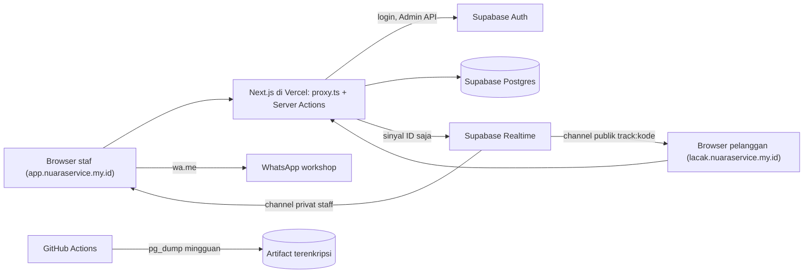

# TRD (Technical Requirements Document) - Nuara Dashboard

> Versi: 0.2 | Diperbarui: 2026-11-04 | Merujuk: PRD.md
<!-- Proyek existing: landing page statis di root repo tetap apa adanya. Dashboard adalah aplikasi baru di folder dashboard/. -->

## 1. Tech Stack
Versi mayor di bawah dicek ulang ke dokumentasi resmi saat L-01.

| Lapisan | Pilihan | Versi mayor | Alasan (1 kalimat) |
|---|---|---|---|
| Frontend | Next.js (App Router) + React, Tailwind CSS, shadcn/ui | Next 16, React 19, Tailwind 4 | Pilihan Pemilik; satu aplikasi untuk tampilan dan server. |
| Backend | Next.js Server Actions + Route Handlers, Drizzle ORM + postgres.js (`prepare: false`), Zod | Drizzle 0.x/1.x, Zod 4 | Tidak perlu server terpisah; Drizzle menulis Postgres standar sehingga mudah pindah ke Supabase self-host. |
| Database | Supabase Postgres, region Singapura (L-02: satu proyek pengembangan/tes; L-36: proyek produksi) | Postgres 17 | Pilihan Pemilik; paket gratis, ada tampilan tabel. |
| Auth | Supabase Auth (email sintetis + password) lewat `@supabase/supabase-js` dan `@supabase/ssr`; peran dan status aktif di tabel `profiles` | - | Keputusan Pemilik 2026-11-04 (mengganti Better Auth): satu penyedia untuk Auth, database, dan Realtime. |
| Penyimpanan file | Tidak berlaku: tidak ada upload foto/file (PRD 6) | - | - |
| Hosting/Deploy | Vercel paket Hobby (proyek kedua, Root Directory `dashboard/`), region fungsi `sin1` | - | Sudah dipakai untuk landing page; Hobby dipilih Pemilik walau ketentuan Vercel membatasinya untuk pemakaian non-komersial (bagian 9). |
| Layanan pihak ketiga | Supabase Realtime (Broadcast), WhatsApp `wa.me`, Google Maps (link rute), RawBT (cetak Bluetooth Android), library `qrcode` | - | Semua gratis; tanpa API berbayar. |

Runtime & package manager: Node 24 LTS, npm (bawaan Node). PWA: `app/manifest.ts` + service worker minimal (hanya agar bisa dipasang, tanpa cache data). drizzle-kit hanya mengelola schema `public` (`schemaFilter`); schema `auth` dikelola Supabase dan hanya dirujuk untuk FK `profiles.id`.

## 2. Arsitektur
Satu aplikasi Next.js melayani dua host: `app.nuaraservice.my.id` (dashboard staf, wajib login) dan `lacak.nuaraservice.my.id` (halaman tracking publik). `src/proxy.ts` (Next.js 16, berjalan di Node.js) hanya mengatur host dan menyegarkan sesi Supabase di host `app.`; host `lacak.` hanya melayani `/<kode>` (di-rewrite ke `/lacak/<kode>`) dan aset statis, serta tidak memanggil Supabase Auth. Semua baca/tulis data lewat Server Actions/Route Handlers yang memverifikasi identitas dengan `getClaims()`, lalu membaca peran dan status aktif dari `profiles` pada setiap permintaan, sebelum memakai Drizzle ke Postgres. Setelah data berubah dan transaksi berhasil, server mengirim sinyal Realtime berisi ID saja; browser yang mendengar mengambil ulang data lewat server. Channel `staff` bersifat privat (hanya staf aktif yang bisa menerima, klien tidak bisa mengirim); channel `track:<kode>` publik tanpa data. Kabar ke pelanggan dikirim staf lewat link `wa.me`. Backup mingguan dibuat GitHub Actions.



Keputusan penting:
| Keputusan | Alternatif ditolak | Alasan |
|---|---|---|
| Server Actions sebagai lapisan data | REST API terpisah | Satu aplikasi, lebih sedikit kode; kontrak operasi di BSD bagian 6. |
| Drizzle ORM + postgres.js lewat pooler Supabase, `prepare: false` | Prisma; query lewat supabase-js | Postgres standar, ringan di serverless, siap pindah ke self-host; pooler mode transaksi tidak mendukung prepared statements. |
| Supabase Auth dengan email sintetis `<username>@staf.nuaraservice.my.id`; akun dibuat Pemilik lewat Admin API, pendaftaran publik dimatikan | Better Auth (rencana awal); Auth Supabase tanpa username | Keputusan Pemilik 2026-11-04. Supabase Auth hanya mengenal email atau telepon, jadi username dipetakan ke email sintetis yang tidak pernah dipakai mengirim email. Masalah peran `admin` yang berkuasa penuh di plugin admin Better Auth ikut hilang. |
| Peran dan status aktif hanya di `profiles`, tidak di JWT, `user_metadata`, atau `app_metadata` | Klaim peran di JWT (custom claims atau Auth hook) | Nonaktif akun harus berlaku di permintaan berikutnya, sedangkan JWT yang sudah terbit tetap valid sampai kedaluwarsa; `user_metadata` bisa diubah pengguna sendiri. |
| Identitas dari `getClaims()`, peran dan `is_active` dari `profiles` di setiap permintaan | `getUser()` tiap permintaan; `getSession()` | `getClaims()` memverifikasi tanda tangan JWT (lokal bila proyek memakai signing keys asimetris); `getSession()` tidak boleh dipercaya di server. |
| `src/proxy.ts` hanya rewrite host + segarkan sesi; pemeriksaan database di layout server dan Server Action | Semua pemeriksaan (peran, `is_active`, `must_change_password`) di proxy | Dokumentasi Next.js: proxy untuk logika ringan, dan Server Action tidak otomatis terlindungi proxy. |
| Realtime: Broadcast berisi ID saja; `staff` privat (RLS pada `realtime.messages`, tanpa policy kirim untuk klien), `track:<kode>` publik | `postgres_changes` + RLS; semua channel publik | Klien tanpa login tidak bisa menerima atau memalsukan sinyal staf; data tetap diambil ulang lewat server. |
| Server mengirim Broadcast lewat REST (`httpSend`) dengan secret key, setelah transaksi berhasil, best-effort | `realtime.send` dari database | Tidak bergantung pada partisi harian `realtime.messages`; kegagalan kirim tidak menggagalkan penyimpanan. |
| RLS aktif tanpa policy di semua tabel `public` + Data API Supabase dimatikan | Mengandalkan publishable key tidak dibagikan | Publishable key ada di browser (Realtime, sesi); tabel tidak boleh terbaca lewatnya. |
| Satu aplikasi, dua host via `proxy.ts` | Dua aplikasi Next.js | Satu deploy, satu basis kode. |
| Host `lacak.` hanya melayani tracking dan aset; host `app.` menolak `/lacak/*` | Semua rute terbuka di kedua host | Tracking publik tidak mengekspos `/masuk`, `/api`, atau rute staf. |
| Cetak lewat halaman cetak + CSS `@page` 58/80 mm | Perintah ESC/POS langsung | Jalan di driver printer Windows dan print service RawBT di Android. |
| Kabar WA lewat `wa.me` | WhatsApp API | Gratis, tanpa risiko nomor diblokir (P5.F05.1). |
| Uang integer rupiah; saldo dihitung dari mutasi kas | Kolom saldo yang diubah langsung | Akurat dan bisa diaudit; pembatalan tidak menghapus jejak. |
| CI menjalankan lint, typecheck, unit test, build; E2E dijalankan lokal tiap langkah | E2E di CI | E2E memakai database tes bersama; menghindari data bentrok. |

## 3. Struktur Folder
```
/                         # landing page statis (index.html, style.css, script.js, assets/) - tidak disentuh
docs/                     # 6 dokumen + _wawancara.md (tidak di-deploy, lihat .vercelignore)
.github/workflows/        # dashboard-ci.yml, db-backup.yml
dashboard/
  src/
    app/
      (auth)/masuk/               # S-01
      (app)/                      # layout staf: sidebar + tab bawah; memeriksa sesi, profil, must_change_password
        beranda/ tiket/ tiket/baru/ tiket/[id]/ pelanggan/ stok/ jual/
        kas/ absensi/ laporan/ staf/ pengaturan/ notifikasi/ ganti-password/
      cetak/                      # halaman cetak thermal (S-08, S-09)
      lacak/[kode]/               # halaman tracking publik (S-07)
      manifest.ts
    components/
      ui/                         # komponen shadcn/ui
      ...                         # komponen fitur (ticket-form, stage-badge, dll.)
    server/
      db/schema/                  # skema Drizzle per domain
      db/client.ts
      actions/                    # Server Actions per fitur
      services/                   # aturan bisnis: tahap, uang, stok, absensi, laporan
      auth/                       # klien Supabase (server, admin), requireSession, requireRole
      realtime.ts  permissions.ts
    lib/                          # format rupiah/tanggal, nomor WA, crypto, wa-link, klien Supabase browser
    proxy.ts                      # rewrite host, segarkan sesi (host app.), blokir rute salah host
  drizzle/                        # file migrasi
  scripts/                        # seed-dev.ts, seed-prod.ts, reset-owner-password.ts
  tests/unit/  tests/e2e/
  public/                         # ikon PWA, logo
```

## 4. Konvensi Kode
- Bahasa & mode ketat: TypeScript `strict`.
- Penamaan: file `kebab-case`, komponen `PascalCase`, fungsi/variabel `camelCase`, tabel & kolom `snake_case` (tabel jamak), rute URL Bahasa Indonesia (`/tiket/baru`).
- Validasi input: Zod di setiap Server Action (server), skema yang sama dipakai form di client.
- Penanganan error: Server Action mengembalikan `{ ok: true, data }` atau `{ ok: false, error: { code, message } }`; `message` berbahasa Indonesia, teksnya persis dari AFD.
- Otorisasi: setiap Server Action memanggil `requireRole(...)` (identitas dari `getClaims()`, lalu `profiles`: peran, `is_active`) dan aturan kepemilikan dari BSD bagian 5 sebelum menyentuh data. Pemeriksaan database tidak ditaruh di `proxy.ts`.
- Koneksi database: postgres.js dengan `prepare: false` untuk `DATABASE_URL` (pooler mode transaksi).
- Uang: integer rupiah (`bigint`), tidak pernah float. Waktu disimpan UTC (`timestamptz`), ditampilkan Asia/Jakarta.
- Lint/format: ESLint (konfigurasi Next.js) + Prettier.
- Dilarang: `any`; SQL mentah tanpa parameter (pakai builder Drizzle atau `sql` bertemplate); secret di kode; query database dari komponen client; mengubah atau menghapus baris uang/stok (pakai pembatalan); data pribadi di payload Realtime atau di URL selain kode tracking; `getSession()` atau `user_metadata` untuk keputusan otorisasi; secret key Supabase di kode yang sampai ke browser.

## 5. Keamanan
- Autentikasi: Supabase Auth, email sintetis + password. Pengaturan Auth: pendaftaran baru dimatikan, panjang minimum password 8, konfirmasi email tidak dipakai (akun dibuat lewat Admin API dengan email terkonfirmasi). Login lewat Server Action `signIn` (cek kunci, lalu `signInWithPassword`).
- Sesi: cookie `@supabase/ssr` dengan opsi `maxAge` 30 hari (default pustaka 400 hari; opsi dicek di L-04); cookie diperbarui setiap token disegarkan, jadi berlaku 30 hari sejak aktivitas terakhir. Pengaturan masa sesi Supabase (time-box, inactivity timeout) hanya tersedia di paket Pro dan tidak dipakai. Cookie sesi bisa dibaca JavaScript (diperlukan klien Realtime), jadi ada header keamanan dasar (CSP, `frame-ancestors 'none'`, `X-Content-Type-Options`) dan tidak ada HTML dari pengguna.
- Nonaktif akun: `profiles.is_active = false` (berlaku di permintaan berikutnya) ditambah `ban_duration` di Supabase Auth (mencegah login dan penerbitan token baru; diuji di L-24). JWT yang sudah terbit tetap valid sampai kedaluwarsa (umumnya 1 jam; dicek di L-02) tetapi ditolak server karena `is_active`.
- Wajib ganti password: `profiles.must_change_password`, dicek di layout server. Ganti password: verifikasi password lama lewat `signInWithPassword`, penggantian lewat Admin API (tidak bergantung pengaturan "secure password change" Supabase, yang butuh email nyata).
- Lupa password: staf direset Pemilik (password sementara + `must_change_password = true`); Pemilik direset lewat `npm run owner:reset-password` dari komputer pengembang. Pemulihan lewat email tidak tersedia (email sintetis).
- Otorisasi: per peran dan kepemilikan tiket, rujuk BSD bagian 5; dicek di server, bukan hanya disembunyikan di UI.
- Batas & penyalahgunaan: login salah 5x per 15 menit pada pasangan (username + IP) -> pasangan itu dikunci 15 menit; satu IP dengan >= 20 kegagalan per 15 menit diblokir 15 menit (tabel `login_attempts`, IP dari `x-forwarded-for` Vercel), sehingga orang luar tidak bisa mengunci akun Pemilik. Batas bawaan Supabase: endpoint token (login dan penyegaran) 150 permintaan per 5 menit per IP; karena login dan penyegaran dilakukan dari server Vercel, semua staf berbagi IP keluar yang sama, cukup untuk 4-6 staf. Kode tracking 10 karakter base62 acak dari `crypto` (tidak bisa ditebak); tidak ada upload.
- Data sensitif: password/pola unit dienkripsi AES-256-GCM (`UNLOCK_SECRET_KEY`), hanya bisa dibuka Teknisi yang ditugaskan, Admin, Pemilik (setiap pembukaan dicatat di `audit_logs`), dihapus saat Diambil/Dibatalkan. GPS absen hanya disimpan sebagai jarak. Semua tabel `public` `ENABLE ROW LEVEL SECURITY` tanpa policy; Data API Supabase dimatikan.
- Secrets: hanya lewat environment variable (bagian 6). `SUPABASE_SECRET_KEY` melewati RLS dan hanya dipakai di server.

## 6. Environment & Deploy
| Env | Tujuan | URL | Catatan |
|---|---|---|---|
| local | pengembangan & E2E | http://localhost:3000 dan http://lacak.localhost:3000 | Memakai proyek Supabase tes + data contoh |
| preview | cek cabang di Vercel | URL preview Vercel | Memakai proyek Supabase tes |
| production | dipakai workshop | https://app.nuaraservice.my.id, https://lacak.nuaraservice.my.id | Proyek Vercel kedua. Sampai rilis (L-36) env production menunjuk proyek Supabase tes (app. berperan sebagai staging); proyek Supabase produksi dibuat di L-36, lalu env production dialihkan. |

Pengaturan Supabase (dilakukan di L-02, diulang untuk proyek produksi di L-36): Data API dimatikan; pendaftaran baru di Auth dimatikan; panjang minimum password 8; Realtime "Allow public access" tetap aktif (channel tracking publik, perlindungan `staff` lewat channel privat + RLS).

Variabel lingkungan (nama saja; disalin ke `dashboard/.env.example` di L-01):
| Nama | Untuk | Didapat dari |
|---|---|---|
| DATABASE_URL | Koneksi aplikasi (pooler, mode transaksi, `prepare: false`) | Supabase > Connect |
| DATABASE_URL_DIRECT | Migrasi dan backup (koneksi langsung) | Supabase > Connect |
| NEXT_PUBLIC_SUPABASE_URL | Klien Auth dan Realtime | Supabase > Project Settings > API |
| NEXT_PUBLIC_SUPABASE_PUBLISHABLE_KEY | Klien browser (Realtime) dan sesi SSR; aman di browser | Supabase > API Keys (`sb_publishable_...`) |
| SUPABASE_SECRET_KEY | Server saja: Auth Admin API (buat staf, reset password, nonaktifkan) dan kirim Broadcast; melewati RLS | Supabase > API Keys (`sb_secret_...`) |
| UNLOCK_SECRET_KEY | Enkripsi password/pola unit (32 byte, base64) | Dibuat acak |
| APP_URL | Link di dashboard | `https://app.nuaraservice.my.id` |
| TRACKING_URL | Link tracking di WA dan QR | `https://lacak.nuaraservice.my.id` |
| SEED_SAMPLE_PASSWORD | Password akun contoh; hanya proyek tes, tidak dipakai di produksi | Dibuat sendiri |

Catatan: kunci Supabase memakai sistem baru (publishable dan secret); kunci lama `anon` dan `service_role` dihentikan Supabase pada akhir 2026. Tampilan dashboard Supabase dicek di L-02.

Secret GitHub Actions: `PROD_DATABASE_URL_DIRECT`, `BACKUP_PASSPHRASE`.

CI/CD:
- `dashboard-ci.yml`: saat push/PR yang mengubah `dashboard/**`: `npm ci`, lint, typecheck, unit test, build.
- Vercel: `main` -> production, cabang lain -> preview. Landing page tetap di proyek Vercel lama; `.vercelignore` root mengecualikan `dashboard`, `docs`, `.github`.
- `db-backup.yml`: setiap Minggu 23.00 WIB, `pg_dump` produksi (Postgres 17), dienkripsi `gpg --symmetric`, disimpan sebagai artifact 60 hari (8 salinan terakhir). Cara pemulihan ditulis di `dashboard/scripts/README.md` (L-32).

## 7. Perintah & Testing
<!-- Sumber tunggal perintah proyek. CLAUDE.md menyalin tabel ini; ubah keduanya bersamaan. Semua perintah dijalankan dari folder dashboard/. -->
| Tujuan | Perintah |
|---|---|
| Dev | `npm run dev` |
| Test | `npm test` (unit, Vitest) dan `npm run test:e2e` (Playwright, database tes) |
| Lint | `npm run lint` |
| Typecheck | `npm run typecheck` |
| Build | `npm run build` |
| Migrasi DB | `npm run db:generate` (buat migrasi) lalu `npm run db:migrate` |
| Seed | `npm run db:seed:dev` (data contoh, hanya database tes), `npm run db:seed:prod` (pengaturan + akun awal) |
| Reset password Pemilik | `npm run owner:reset-password -- --username <u>` |

- Unit (Vitest): aturan di `server/services/` (transisi tahap, tagihan/dibayar/sisa/kelebihan bayar, saldo kas, harga modal rata-rata, stok tidak minus, garansi & masa aktif link, jarak GPS dan radius, terlambat, laporan bulanan), kunci login per (username, IP), format nomor WA dan rupiah, samaran nama, izin per peran.
- E2E (Playwright, lokal): alur P0 lengkap (login Admin -> buat tiket + DP -> tandai WA terkirim -> Teknisi diagnosa + estimasi -> disetujui -> Pengerjaan -> Selesai + garansi -> lunas -> tracking menampilkan tahap -> Diambil), alur batal (Ditolak -> Dibatalkan -> Dikembalikan), ditambah satu skenario per fitur P1 saat langkahnya dikerjakan.

## 8. Non-Fungsional Teknis
- Performa: tracking dirender di server, tanpa komponen interaktif berat selain klien Realtime, font Archivo di-subset; target < 2 detik di 4G. Dashboard < 3 detik di 4G. Realtime: perubahan terlihat di layar lain <= 5 detik; pemuatan ulang akibat sinyal digabung (staf paling sering sekali per 2 detik, tracking sekali per 3 detik) agar sinyal beruntun tidak membanjiri server.
- Skala awal: 100-200 tiket/bulan (sekitar 2.400/tahun), 4-6 akun; jauh di bawah batas paket gratis Supabase (500 MB). Indeks di BSD bagian 3.
- Observability: log fungsi Vercel; `audit_logs` untuk perubahan data penting; error Server Action dicatat dengan kode error tanpa data pribadi.

## 9. Risiko Teknis
- Vercel Hobby: ketentuan Vercel membatasi Hobby untuk pemakaian pribadi non-komersial (https://vercel.com/docs/limits/fair-use-guidelines). Pemilik memutuskan tetap memakai Hobby (2026-11-04) -> akun atau proyek bisa dijeda atau ditutup Vercel sewaktu-waktu -> kode tidak memakai fitur khusus Vercel (bisa dijalankan dengan `next start` di VPS, rencana Pemilik), backup mingguan, pantau email dari Vercel.
- Paket gratis Supabase: proyek dijeda setelah 7 hari tanpa aktivitas database dan tanpa backup harian -> proyek produksi baru dibuat di L-36 (tidak menganggur selama build); setelah rilis, libur panjang > 7 hari bisa menjeda proyek (pulihkan lewat dashboard Supabase; ada batas waktu pemulihan di dokumentasi Supabase); backup mingguan sendiri (`db-backup.yml`); Pemilik berencana pindah ke Supabase self-host di VPS setelah rilis.
- Koneksi langsung Supabase hanya IPv6, sedangkan GitHub Actions dan sebagian jaringan hanya IPv4 -> perbaikan ditunda atas permintaan Pemilik (audit S1); bila `db:migrate` (L-03) atau backup (L-32) gagal tersambung, pakai session pooler dari dashboard Supabase. Dicatat di IPD.
- Sinyal Realtime: "Allow public access" harus tetap aktif (channel tracking publik), jadi perlindungan `staff` bergantung pada `private: true` dan policy RLS -> diuji di L-14 (klien tanpa login tidak bisa join `staff`, sinyal palsu tidak memicu muat ulang). Staf yang dinonaktifkan masih bisa menerima sinyal berisi ID saja sampai JWT-nya habis (otorisasi Realtime dievaluasi saat join atau saat token dikirim ulang). Sinyal palsu di `track:<kode>` hanya bisa dikirim pemegang kode tracking.
- Realtime privat dan pengiriman REST dari server belum diuji di proyek ini -> diuji di L-14; payload hanya ID sehingga mudah diganti (mis. polling) bila perilakunya berbeda.
- Cookie sesi Supabase bisa dibaca JavaScript -> header keamanan dasar (bagian 5), tanpa HTML dari pengguna, secret key tidak pernah ke browser.
- Email sintetis: validasi email Supabase pada jalur yang dipakai hanya memeriksa format, dan email tidak pernah dikirim -> dicek di L-04 (`createUser` di proyek tes); bila ditolak, ganti domain sintetis sebelum akun produksi dibuat (L-36).
- Batas Supabase Auth per IP (150 permintaan per 5 menit di endpoint token) berlaku untuk IP keluar Vercel yang dibagi semua staf -> cukup untuk 4-6 staf; kunci login per (username, IP) menahan percobaan berulang sebelum sampai ke Supabase.
- `proxy.ts` tidak melindungi Server Action (matcher yang mengecualikan jalur juga melewati Server Action di jalur itu) -> otorisasi dicek di setiap Server Action dan layout server.
- Cetak Bluetooth Android lewat RawBT berbeda per printer -> diuji dengan printer asli di L-17; cadangan: cetak dari laptop, kirim link lewat WA.
- GPS di dalam bangunan meleset 20-50 m -> radius 100 m; absen di luar radius ditolak, sedangkan izin lokasi ditolak atau GPS tidak terbaca tetap boleh dengan tanda "lokasi tidak terverifikasi" (celah yang disengaja, terlihat Pemilik di rekap).
- Safari iPhone (pemasangan PWA, izin lokasi, cetak) berbeda dari Chrome -> diuji di L-34.
- Versi library dan nama kunci Supabase cepat berubah -> versi dicek ke dokumentasi resmi di L-01 dan L-02, dan dicatat di IPD.
